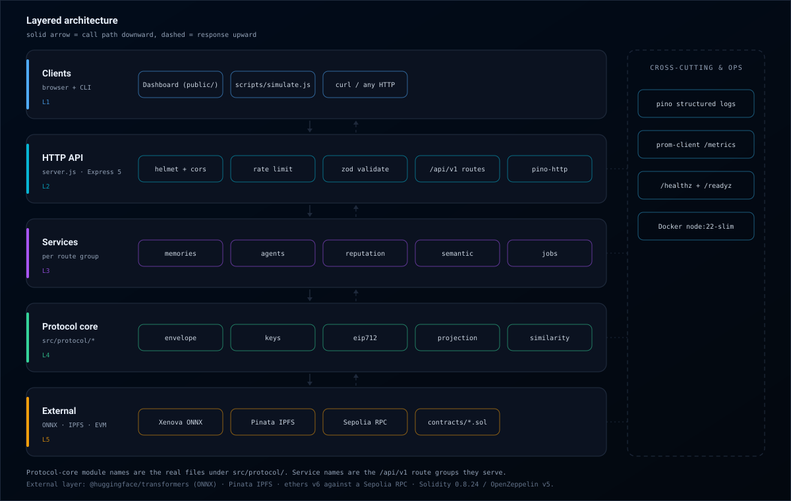
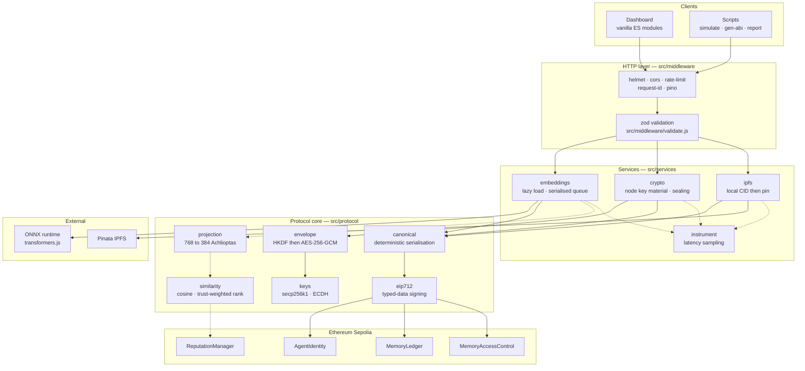
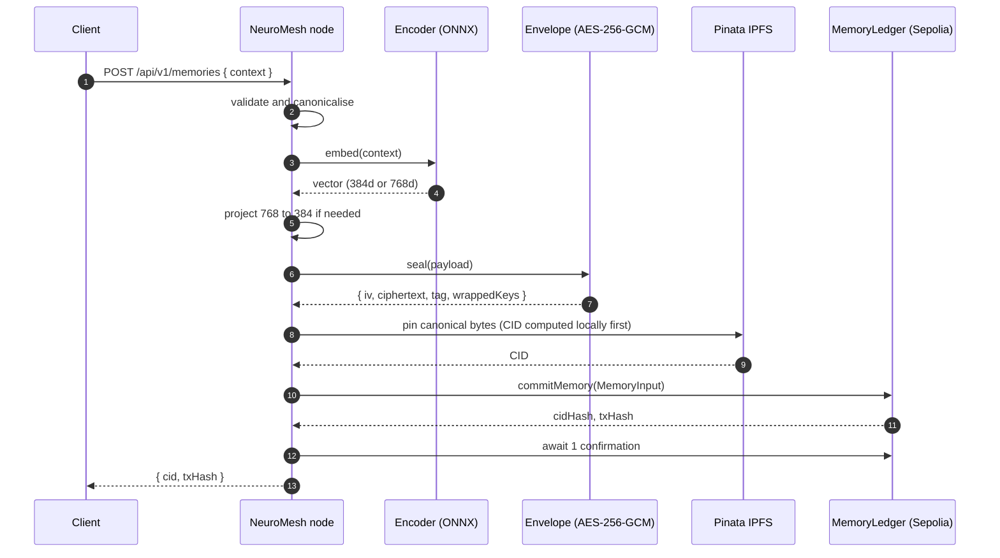
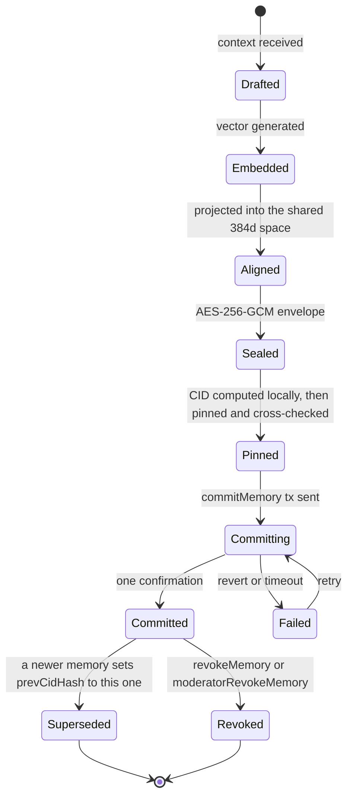
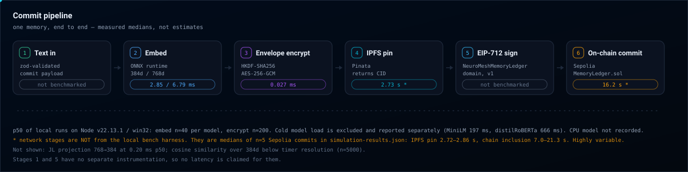
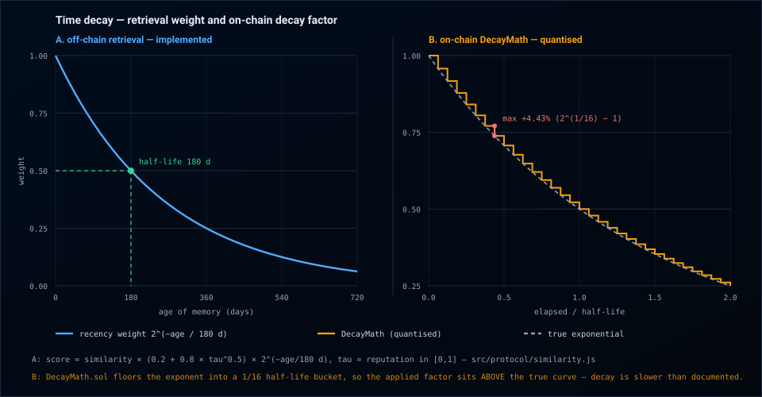
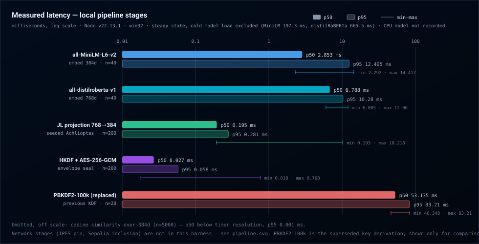

<div align="center">

<picture>
  <source media="(prefers-color-scheme: dark)" srcset="./assets/hero.svg">
  
</picture>

<br/>

_Heterogeneous AI agents commit **encrypted** memories to IPFS and prove ownership on Ethereum.<br/>Research prototype. Sepolia testnet only. Unaudited._

<br/>

<!-- Row A — build & licence -->
<p>
<a href="https://github.com/v3nom-95/NeuroMesh/actions/workflows/ci.yml"></a>
<a href="https://github.com/v3nom-95/NeuroMesh/actions/workflows/codeql.yml"></a>
<a href="./LICENSE"></a>
</p>

<!-- Row B — platform -->
<p>


</p>

<!-- Row C — measured facts -->
<p>


</p>

<!-- Row D — honesty row -->
<p>


</p>

<br/>

<picture>
  <source media="(prefers-color-scheme: light)" srcset="./assets/logo-light.svg">
  
</picture>

</div>

---

## What it is

NeuroMesh is a **research prototype of a memory layer for autonomous AI agents**. An agent turns a piece of
context into a sentence embedding, seals the context under AES-256-GCM with a per-memory content key, pins the
resulting envelope to IPFS, and commits only the content identifier — never the plaintext — to a Solidity
contract on Ethereum Sepolia. Other agents can then search that memory pool semantically, with results
re-ranked by the committing agent's on-chain reputation and by the memory's age. Because agents run different
encoders that emit different-dimensional vectors, embeddings are projected into a shared 384-dimensional space
through a deterministic, versioned sparse random projection before they are compared.

The repository contains four Solidity contracts (223 Hardhat tests), a protocol core and service layer in
Node 22 ESM (393 `node:test` tests), an Express 5 node, and a vanilla ES-module dashboard. Both test counts
in this document were produced by running the suites, not quoted from a previous run.

> [!IMPORTANT]
> **The rewrite is mid-flight, and this README says so throughout.** `src/protocol/`, `src/services/`,
> `src/middleware/` and `src/config/` are finished and tested; the versioned HTTP router that would connect
> them is not written yet, so [`server.js`](./server.js) still serves the v1 surface. Every section below
> marks what is wired from what is merely implemented.

### What it is **not**

> [!WARNING]
> **Nothing here is audited, nothing is on mainnet, and the deployed contracts are a superseded version.**
> Do not place anything of value in it.

| NeuroMesh **is**                                                                                                                         | NeuroMesh **is not**                                                                                                                                                                                                                                                                 |
| ---------------------------------------------------------------------------------------------------------------------------------------- | ------------------------------------------------------------------------------------------------------------------------------------------------------------------------------------------------------------------------------------------------------------------------------------ |
| A working prototype of an agent-memory protocol, exercised on Sepolia                                                                    | **Not audited.** The v2.1 hardening pass fixed 7 of 12 tracked findings, including the critical one. **4 remain open — 3 high, 1 medium** — listed in [docs/SECURITY-NOTES.md](./docs/SECURITY-NOTES.md) and tracked in [docs/V2.1-HARDENING-PLAN.md](./docs/V2.1-HARDENING-PLAN.md) |
| Real AES-256-GCM envelope encryption performed before context leaves the node ([`src/protocol/envelope.js`](./src/protocol/envelope.js)) | **Not a zero-knowledge system.** There are no ZK proofs anywhere in this repository. Encryption hides content; it proves nothing about it                                                                                                                                            |
| Real IPFS pinning through Pinata, producing real CIDs                                                                                    | **Not solved cross-model alignment.** A random projection preserves distances _within_ one source space; it does not align two independently trained encoders. See [Known limitations](#known-limitations)                                                                           |
| Four Solidity contracts with role-based access control, pausability and a decaying reputation model                                      | **Not a live swarm.** The sample run drives five agent roles from a single wallet, so the identity and sybil surfaces are not genuinely exercised                                                                                                                                    |
| A reproducible local latency harness with n = 40–5000 per measurement                                                                    | **Not a production trust network.** Reputation events in the sample run are modelled off-chain, not submitted as transactions                                                                                                                                                        |
| Apache-2.0 licensed, with a documented threat model                                                                                      | **Not a token, and not an incentive layer.** There is no economic security of any kind                                                                                                                                                                                               |

---

## Contents

- [What it is](#what-it-is)
- [Architecture](#architecture)
- [The commit pipeline](#the-commit-pipeline)
- [Quick start](#quick-start)
- [Configuration](#configuration)
- [REST API](#rest-api)
- [Smart contracts](#smart-contracts)
- [Deployed addresses](#deployed-addresses)
- [Benchmarks](#benchmarks)
- [Known limitations](#known-limitations)
- [Security](#security)
- [Project structure](#project-structure)
- [Technology stack](#technology-stack)
- [Related work](#related-work)
- [Documentation](#documentation)
- [Contributing](#contributing)
- [Releases](#releases)
- [Licence](#licence)

---

## Architecture

<picture>
  <source media="(prefers-color-scheme: dark)" srcset="./assets/architecture.svg">
  
</picture>



This is the **target** wiring, and none of it is reachable over HTTP yet. [`server.js`](./server.js)
still implements the client-to-external path directly against `lib/` and the deprecated encoder package,
bypassing every `src/` box above; the middleware, service and protocol layers are written and unit-tested,
but the versioned router that would mount them (`src/routes/`) does not exist in this tree. The dotted
edges are further out still — `projection` and `similarity` have no caller anywhere outside the test
suite. See [REST API](#rest-api).

<details>
<summary><b>Commit sequence (target design) — who talks to whom, in order</b></summary>



</details>

<details>
<summary><b>Memory record lifecycle</b></summary>



</details>

A layered view with the observability rail is in [docs/ARCHITECTURE.md](./docs/ARCHITECTURE.md).

---

## The commit pipeline

<picture>
  <source media="(prefers-color-scheme: dark)" srcset="./assets/pipeline.svg">
  
</picture>

1. **Canonicalise.** The memory payload is serialised deterministically — sorted keys, `U+001F` unit
   separators, no floating-point ambiguity — so that two independent implementations hash the same bytes.
   [`src/protocol/canonical.js`](./src/protocol/canonical.js)
2. **Embed.** `Xenova/all-MiniLM-L6-v2` (384d) or `Xenova/all-distilroberta-v1` (768d) through
   `@huggingface/transformers`, mean-pooled and L2-normalised.
3. **Align.** A 768d vector is projected into the shared 384d space by a **deterministic** sparse Achlioptas
   projection whose matrix is derived from an AES-256-CTR keystream seeded by a fixed label. The resulting
   `projectionId` is recorded with the memory, and similarity comparisons refuse to mix projection IDs.
   [`src/protocol/projection.js`](./src/protocol/projection.js)
4. **Seal.** A random 32-byte content-encryption key (CEK) encrypts the payload under AES-256-GCM with a
   12-byte IV and a 16-byte tag. The CEK is then wrapped once per recipient using ECDH over secp256k1 plus
   HKDF-SHA256 (`ECIES-secp256k1-HKDF-SHA256-AES256GCM/v1`). The signing key never doubles as the encryption
   key. [`src/protocol/envelope.js`](./src/protocol/envelope.js) and [`src/protocol/keys.js`](./src/protocol/keys.js)
5. **Sign.** The commit is authorised with an EIP-712 typed-data signature over one of three domains —
   `NeuroMeshAgentIdentity`, `NeuroMeshMemoryLedger`, `NeuroMeshAccessControl`.
   [`src/protocol/eip712.js`](./src/protocol/eip712.js)
6. **Pin, then commit.** The envelope goes to IPFS; only `(cid, prevCidHash, model, embeddingDim,
isEncrypted)` reaches the chain. Plaintext never leaves the node.

Retrieval reverses steps 3 and 4 and adds ranking:

```text
score = cosine(query, candidate) x (theta + (1 - theta) * tau^phi) x 2^(-age_days / 180)

        theta = 0.2      phi = 0.5      recency half-life = 180 days
```

`tau` is the agent's calibrated on-chain trust in `[0, 1]`. Because `theta` is a **floor**, reputation
**re-ranks but never gates** — a zero-reputation agent's memory is demoted, not hidden. `rankMemories()`
applies this weighting; `semanticSearch()` is the deliberately pure-similarity variant.
[`src/protocol/similarity.js`](./src/protocol/similarity.js)

<picture>
  <source media="(prefers-color-scheme: dark)" srcset="./assets/trust-curve.svg">
  
</picture>

---

## Quick start

**Prerequisites** — Node >= 20 (developed on v22.13.1), npm >= 10, a Sepolia RPC URL, a funded Sepolia key,
and a Pinata JWT. The first run downloads ONNX model weights into `./.cache/transformers`; expect it to be
slow once and fast afterwards.

```bash
git clone https://github.com/v3nom-95/NeuroMesh.git && cd NeuroMesh
npm ci
cp .env.example .env          # then edit it — see Configuration below
npm test                      # 393 backend + 223 contract tests
npm run dev                   # http://localhost:7860
```

> **Never commit `.env`.** It is gitignored and holds a funded private key and a Pinata JWT.
> `.env.example` contains placeholders only. Verify with `git check-ignore -v .env && git ls-files .env`.

<details>
<summary><b>Docker</b></summary>

<br/>

The image is built on `node:22-bookworm-slim`. **Alpine will not work** — `onnxruntime-node` ships glibc
binaries.

```bash
npm run docker:build          # docker build -t neuromesh-protocol:local .
npm run docker:run            # docker run --rm --env-file .env -p 7860:7860 ...

# or the full stack, including an optional local EVM:
docker compose up --build
docker compose --profile local-chain up
```

The container runs as the unprivileged `node` user, exposes `7860`, and carries a `HEALTHCHECK` that polls
`/healthz` with a 180-second start period to cover model warm-up.

</details>

<details>
<summary><b>Contracts</b></summary>

<br/>

```bash
npm run compile               # solc 0.8.24, optimizer runs=200, evmVersion cancun
npm run test:contracts        # 223 Hardhat tests
npm run coverage:sol
npm run deploy:sepolia
```

> [!CAUTION]
> `scripts/deploy.js` is **stale and will fail**. It still calls the v1 constructors
> (`AgentIdentity.deploy()`, `ReputationManager.deploy(identity)`) and never deploys
> `MemoryAccessControl` at all. The v2 constructors are `(admin)`, `(admin, identity_)` and
> `(admin, identity_, treasury_, trustLogCapacity)`. The correct arguments and ordering are in
> [docs/DEPLOYMENT.md](./docs/DEPLOYMENT.md). Likewise, `npm run verify` points at `scripts/verify.js`,
> which does not exist, and `npm run benchmark` is currently only an alias for `npm run simulate` — it does
> **not** regenerate the statistics in [Benchmarks](#benchmarks).

</details>

---

## Configuration

Configuration is validated at boot by a zod schema in [`src/config/env.js`](./src/config/env.js); the process
exits with a readable error rather than starting half-configured. The schema declares **60 variables**; the
table below is the subset you need to run the node, transcribed from the schema itself. Where
[`.env.example`](./.env.example) disagrees, **the schema wins**. The remaining 35 — transaction queue and
confirmation tuning, model preload and timeout budgets, job/SSE/idempotency lifetimes, semantic index paths,
per-contract address overrides — are documented in [docs/CONFIGURATION.md](./docs/CONFIGURATION.md).

| Variable                       |     Required      | Default                             | Purpose                                                     |
| ------------------------------ | :---------------: | ----------------------------------- | ----------------------------------------------------------- |
| `NODE_ENV`                     |        no         | `development`                       | `development` · `test` · `production`                       |
| `PORT`                         |        no         | `7860`                              | HTTP listen port                                            |
| `HOST`                         |        no         | `127.0.0.1`                         | Bind address; use `0.0.0.0` only inside a container         |
| `LOG_LEVEL`                    |        no         | `info`                              | pino level, including `silent`                              |
| `CORS_ALLOWED_ORIGINS`         |        no         | _(empty)_                           | Comma-separated exact origins. Empty means same-origin only |
| `RATE_LIMIT_MAX`               |        no         | `60`                                | Reads per window per IP                                     |
| `WRITE_RATE_LIMIT_MAX`         |        no         | `10`                                | Gas-spending writes per window                              |
| `SEARCH_RATE_LIMIT_MAX`        |        no         | `20`                                | Semantic searches per window                                |
| `DECRYPT_RATE_LIMIT_MAX`       |        no         | `5`                                 | Decrypt attempts per window                                 |
| `API_AUTH_TOKEN`               | **in production** | —                                   | Bearer token for state-changing routes                      |
| `SEPOLIA_RPC_URL`              | for chain writes  | —                                   | JSON-RPC endpoint                                           |
| `CHAIN_ID`                     |        no         | `11155111`                          | Guards against writing to the wrong network                 |
| `PRIVATE_KEY`                  | for chain writes  | —                                   | The node's signing key. **Never commit**                    |
| `MEMORY_ENCRYPTION_KEY`        |        no         | —                                   | 32-byte hex. Must be distinct from `PRIVATE_KEY`            |
| `CONTRACT_ADDRESSES_PATH`      |        no         | `./contract-addresses.json`         | Where deployed addresses are read from                      |
| `PINATA_JWT`                   |    for pinning    | —                                   | Pinata API bearer token                                     |
| `IPFS_GATEWAY_URL`             |        no         | `https://gateway.pinata.cloud/ipfs` | Read gateway                                                |
| `IPFS_MAX_BYTES`               |        no         | `1048576`                           | Refuse oversized fetches                                    |
| `NEUROMESH_EMBEDDING_PROVIDER` |        no         | `local`                             | `local` or `mock` (CI uses `mock`)                          |
| `EMBEDDING_MODEL`              |        no         | `Xenova/all-MiniLM-L6-v2`           | Primary encoder                                             |
| `EMBEDDING_MODEL_ALT`          |        no         | `Xenova/all-distilroberta-v1`       | 768d encoder                                                |
| `TRANSFORMERS_CACHE`           |        no         | `./.cache/transformers`             | Model cache directory                                       |
| `MAX_CONTEXT_CHARS`            |        no         | `8000`                              | Upper bound on a submitted context                          |
| `METRICS_ENABLED`              |        no         | `true`                              | Prometheus exposition                                       |
| `ENABLE_LEGACY_ROUTES`         |        no         | `false`                             | Mount the unversioned `/api/*` surface                      |

> [!NOTE]
> `.env.example` documents `CORS_ORIGINS` and `API_KEY` as aliases. **They are not recognised by the schema**,
> and `PBKDF2_ITERATIONS`, `EMBEDDING_DIM` and `TARGET_EMBEDDING_DIM` are vestigial. Eight points of drift are
> catalogued in [docs/CONFIGURATION.md](./docs/CONFIGURATION.md).

---

## REST API

> [!IMPORTANT]
> The versioned `/api/v1` router is **in progress and not yet mounted** — `src/routes/` does not exist in
> this tree. What follows is what [`server.js`](./server.js) actually serves today.

### Served today

| Method | Path                      | Auth | Response                                                                         |
| ------ | ------------------------- | :--: | -------------------------------------------------------------------------------- |
| `GET`  | `/api/status`             | none | `{ agentAddress, isRegistered }`                                                 |
| `POST` | `/api/register`           | none | `{ success }` — calls `registerAgent` with a hardcoded placeholder public key    |
| `POST` | `/api/memory`             | none | `{ success, cid, embeddingLength, encrypted }` — embeds, encrypts, pins, commits |
| `GET`  | `/api/memories`           | none | `[{ cid, timestamp }]` from Pinata's pin list; `[]` on any failure               |
| `GET`  | `/api/simulation-results` | none | Contents of `simulation-results.json`, or `404`                                  |
| `POST` | `/api/decrypt`            | none | `{ success, context }`, or `403`                                                 |
| `GET`  | `/*`                      | none | Static files from `public/`                                                      |

> [!WARNING]
> This surface has **no authentication, no rate limiting, no security headers, and a bare `cors()` with no
> allowlist**. It still imports the deprecated Xenova transformers package and hand-written ABI fragments for
> the _pre-rewrite_ contracts, so its `commitMemory` call uses the v1 positional signature. Three concrete
> consequences, all readable in [`server.js`](./server.js):
>
> - `POST /api/memory` spends gas and a paid pinning quota on every unauthenticated request — anyone who can
>   reach the port can drain the wallet.
> - `POST /api/decrypt` takes `encryptedData` straight from the request body and decrypts it with
>   `PRIVATE_KEY`. That is an **unauthenticated decryption oracle**, and because the v1 key derivation is
>   PBKDF2 at 100,000 iterations it is a 53 ms-per-call work oracle as well.
> - The model is `await`ed at module scope above `app.listen`, so nothing answers on the port until a ~90 MB
>   download finishes, and there is no `/healthz` for an orchestrator to wait on.
>
> **Do not expose it to a network.** The full defect list is in [docs/API.md](./docs/API.md); the replacement
> services in [`src/services/`](./src/services) exist specifically to remove each one.

### Planned v2 surface — **not yet mounted**

`/healthz` · `/readyz` · `/metrics` · `/api/v1/status` · `/api/v1/agents/:address` ·
`/api/v1/agents/register` · `/api/v1/memories` (GET, POST) · `/api/v1/memories/:cid` ·
`/api/v1/memories/:cid/decrypt` · `/api/v1/jobs/:id` · `/api/v1/semantic/search` ·
`/api/v1/semantic/similarity` · `/api/v1/reputation` · `/api/v1/reputation/endorse` ·
`/api/v1/reputation/report` · `/api/v1/simulation-results`

Errors will use a single envelope, `{ error: { code, message, requestId } }`, defined in
[`src/errors.js`](./src/errors.js). Full request and response shapes are in [docs/API.md](./docs/API.md).

> [!NOTE]
> **Known route drift.** The shipped dashboard ([`public/js/api.js`](./public/js/api.js)) is written against
> unversioned `/api/...` paths while `ENABLE_LEGACY_ROUTES` defaults to `false`. If the node mounts only
> `/api/v1`, every dashboard call returns 404. Tracked as open decision D2 in
> [docs/ROADMAP.md](./docs/ROADMAP.md).

---

## Smart contracts

Solidity 0.8.24, OpenZeppelin Contracts v5, `evmVersion: cancun`, optimizer at 200 runs. All four inherit
[`NeuroMeshGuarded`](./contracts/base/NeuroMeshGuarded.sol) for role-based access control and pausability.

| Contract                                                         | Responsibility                                                                                                                        | Key functions                                                                                                                                                                 |
| ---------------------------------------------------------------- | ------------------------------------------------------------------------------------------------------------------------------------- | ----------------------------------------------------------------------------------------------------------------------------------------------------------------------------- |
| [`AgentIdentity.sol`](./contracts/AgentIdentity.sol)             | On-chain agent registry: public key, key version, metadata URI, active flag. Supports meta-transactions through EIP-712 and ERC-1271. | `registerAgent` · `registerAgentFor` · `rotateKey` · `setMetadataURI` · `deactivate` · `reactivate` · `adminSetActive` · `isActive` · `getPublicKey` · `getAgents`            |
| [`MemoryLedger.sol`](./contracts/MemoryLedger.sol)               | Immutable CID-anchored memory proofs with version chaining. Stores `keccak256(cid)`, never plaintext.                                 | `commitMemory(MemoryInput)` · `revokeMemory` · `moderatorRevokeMemory` · `exists` · `getMemory` · `getMemoryByCid` · `cidHashOf` · `getVersionChain`                          |
| [`ReputationManager.sol`](./contracts/ReputationManager.sol)     | Decaying Bayesian evidence model with one-hop transitive endorsement weight and staked endorsements.                                  | `endorseAgent` · `revokeEndorsement` · `reportAgent` · `withdrawReport` · `claimStake` · `settle` / `settleBatch` · `reputationOf` · `isTrusted` · `previewEndorsementWeight` |
| [`MemoryAccessControl.sol`](./contracts/MemoryAccessControl.sol) | Per-CID, per-grantee access grants that carry ECDH-wrapped content keys, with expiry.                                                 | `grantAccess` · `grantAccessBatch` · `grantAccessFor` · `revokeAccess` · `moderatorRevokeAccess` · `canAccess` · `getWrappedKey` · `getGrantees`                              |

`MemoryInput` is `{ string cid; bytes32 prevCidHash; string model; uint32 embeddingDim; bool isEncrypted; }`.

**The reputation score, stated exactly as implemented:**

```text
w(i)     = base + (max - base) * reputationOf(i)     // endorsement weight, clamped to [base, max]
score(j) = P / (P + N + prior)                       // WAD, bounded in [0, 1)
```

`P` and `N` are time-decayed positive and negative evidence masses; `prior` defaults to 3.0 as a Bayesian
pseudo-count for "unknown"; a report filed by actor _i_ carries `w(i) * negativeMultiplier`. Decay is lazy —
each agent stores `(P, N, lastSettledAt)`, and `_settle` multiplies both masses by `2^(-dt / halfLife)`. This
is a genuine bounded Bayesian ratio, not the `endorsers * 1000 / (1 + 3 * reports)` integer formula the v1
contract used. **It also carries known defects** — see [Known limitations](#known-limitations).

---

## Deployed addresses

| Contract          | Network            | Address                                      | Explorer                                                                                |
| ----------------- | ------------------ | -------------------------------------------- | --------------------------------------------------------------------------------------- |
| AgentIdentity     | Sepolia (11155111) | `0xD4F91196316f802B67C6B17e0B1845A23beaA2ad` | [view](https://sepolia.etherscan.io/address/0xD4F91196316f802B67C6B17e0B1845A23beaA2ad) |
| MemoryLedger      | Sepolia (11155111) | `0x10701017eC0faed2309E103C51AB503214F940Fb` | [view](https://sepolia.etherscan.io/address/0x10701017eC0faed2309E103C51AB503214F940Fb) |
| ReputationManager | Sepolia (11155111) | `0x8E56B730894474e8770b38b4a4A0428f224635ac` | [view](https://sepolia.etherscan.io/address/0x8E56B730894474e8770b38b4a4A0428f224635ac) |

> [!CAUTION]
> **These are the pre-rewrite v1 deployments, and their ABI does not match the contracts in this
> repository.** `commitMemory` now takes a `MemoryInput` struct instead of positional arguments; the
> reputation scoring model is entirely different; `MemoryAccessControl` was never deployed because it did not
> exist. The v1 contracts have no role-based access control, no pause, and no upgrade path. Anything built
> against `contracts/` today will **not** interoperate with these addresses. Re-deployment is a v2.1 work
> item — see [docs/DEPLOYMENT.md](./docs/DEPLOYMENT.md).

---

## Benchmarks

<picture>
  <source media="(prefers-color-scheme: dark)" srcset="./assets/benchmarks.svg">
  
</picture>

### Measurement A — local primitives

**Methodology.** Node **v22.13.1** on **win32**, in-process `performance.now()` timing, one sequential
process, no concurrency. Warm-up iterations are discarded, and model cold-load is excluded and reported
separately. `n` is stated per row. These are **local CPU primitives only** — no network, no chain.

| Operation                                    |    n |   mean |                  **p50** |    **p95** |    min |    max | stddev |
| -------------------------------------------- | ---: | -----: | -----------------------: | ---------: | -----: | -----: | -----: |
| Embed — `all-MiniLM-L6-v2` (384d)            |   40 |  3.562 |                **2.853** | **12.495** |  2.292 | 14.417 |  2.463 |
| Embed — `all-distilroberta-v1` (768d)        |   40 |  7.095 |                **6.788** | **10.280** |  6.005 | 12.060 |  1.100 |
| Projection 768 to 384                        |  200 |  0.322 |                **0.195** |  **0.281** |  0.193 | 10.218 |  0.942 |
| Envelope encrypt — HKDF-SHA256 + AES-256-GCM |  200 |  0.034 |                **0.027** |  **0.058** |  0.018 |  0.768 |  0.054 |
| _(superseded)_ PBKDF2-100k + AES-256-GCM     |   20 | 56.961 |               **53.135** | **83.210** | 46.348 | 83.210 | 10.541 |
| Cosine similarity, 384d                      | 5000 |  0.001 | _below timer resolution_ |      0.001 |  0.000 |  0.259 |  0.005 |

All values in milliseconds. Cold model load, excluded above: MiniLM **197.3 ms**, distilRoBERTa **665.5 ms**.

**The headline result.** Replacing PBKDF2-100k passphrase stretching with HKDF-SHA256 derivation over a random
CEK cut the per-memory cryptographic cost from a **p50 of 53.135 ms to 0.027 ms** — roughly 1,900x — while
_strengthening_ the model, because the signing key is no longer used as the encryption passphrase.

> [!NOTE]
> Two caveats, stated rather than buried. (1) The projection row was measured against a seeded-xorshift32
> variant, whereas the shipped [`src/protocol/projection.js`](./src/protocol/projection.js) uses AES-256-CTR;
> 0.195 ms is therefore indicative, not exact. (2) `npm run benchmark` is currently an alias for
> `npm run simulate` and does **not** regenerate this table. The manual procedure is specified in
> [docs/BENCHMARKS.md](./docs/BENCHMARKS.md).

### Measurement B — end-to-end, network-bound

A **single** run of [`scripts/simulate.js`](./scripts/simulate.js), **n = 5**, recorded in
`simulation-results.json` (gitignored — regenerate with `npm run simulate`). It used the legacy PBKDF2 code
path, drove five agent roles from one wallet, and **modelled reputation events off-chain** rather than
sending transactions. These numbers are not comparable with Measurement A and are never averaged with it.

| Stage                           |   n |   min | **median** |    max |
| ------------------------------- | --: | ----: | ---------: | -----: |
| IPFS pin (Pinata)               |   5 | 2,722 |  **2,727** |  2,862 |
| Sepolia commit + 1 confirmation |   5 | 7,033 | **16,190** | 21,288 |
| End-to-end per memory           |   5 | 9,888 | **19,160** | 24,298 |

All values in milliseconds. **Over 99% of end-to-end latency is IPFS plus chain inclusion** — public-testnet
jitter, not NeuroMesh. The local AI and cryptographic work together account for well under 10 ms.

### On the cross-model similarity matrix

The similarity matrix printed in earlier versions of this README was produced by an **unseeded** random
projection: the matrix was regenerated per process, so those numbers were noise, not semantics. A chi-squared
test against the pure-noise null does not reject it (chi-squared = 3.82, 6 df, **p = 0.70**). **That matrix is
not reprinted here.** The projection is now deterministic and versioned, but a defensible cross-model
retrieval benchmark has not yet been run, so no matrix is claimed. See
[docs/BENCHMARKS.md](./docs/BENCHMARKS.md).

---

## Known limitations

This section is deliberately long. The contracts carry **4 open review findings — 3 high, 1 medium** (7 of 12 tracked issues, including the critical one, were fixed in the v2.1 hardening pass; the original review returned 21 raw findings deduplicating to 12,
9 medium, 4 low** — deduplicated to 14 distinct issues (SEC-01 … SEC-14) in
[docs/SECURITY-NOTES.md](./docs/SECURITY-NOTES.md) and scheduled as 12 work items in
[docs/V2.1-HARDENING-PLAN.md](./docs/V2.1-HARDENING-PLAN.md). **None of them is fixed in this tree.**

<details open>
<summary><b>Contract findings you should read before touching this code</b></summary>

<br/>

1. **CID front-running — CRITICAL.** `MemoryLedger.commitMemory` awards ownership of a `cidHash` on a
   first-come-first-served basis. An observer who sees a CID before its author's transaction lands can claim
   it, and the claim is **permanent** — not even `MODERATOR_ROLE` can free the hash. The author is
   permanently locked out of anchoring their own memory.
2. **Endorsement stake is unslashable — HIGH.** Any endorser can front-run the slasher with
   `revokeEndorsement` and recover 100% of their stake. The economic deterrent does not exist.
3. **Reports are free, unstaked and permanent — HIGH.** Filing a report costs nothing but gas, cannot be
   removed by the target, and is decay-invariant because `_settle` applies the same factor to `P` and `N`.
   One throwaway identity can destroy any agent's trusted status.
4. **The sybil bar is 8 wallets, not 18 — HIGH.** `ReputationManager`'s own NatSpec claims an attacker needs
   18 distinct endorsers. Its transitive weighting lets clique members bootstrap each other's endorsement
   weight, so **8 mutually-endorsing wallets** suffice.
5. **Decay can be defeated entirely — HIGH.** `DecayMath` quantises to 1/16-half-life buckets, so
   `decayFactor` returns "no decay at all" for any elapsed time under 5.625 days at the default half-life,
   yet `_settle` advances `lastSettledAt` unconditionally and discards the residual. Calling the
   permissionless `settle(x)` every five days freezes an agent's masses forever, in either direction.
6. **DecayMath error is 4.43%, not the documented 0.15% — and it rounds the wrong way.** Flooring the
   _exponent_ inflates the _factor_ by up to `2^(1/16) - 1`, about 4.43%, so scores are biased **upward** —
   roughly 30x the documented error, and in the opposite direction to the NatSpec's "always rounds down"
   claim. Decay is slower than documented.
7. **A suspended agent can self-reinstate — HIGH.** `AgentIdentity.reactivate()` lets an agent immediately
   undo a `REGISTRAR_ROLE` suspension, which makes moderation unenforceable.
8. **On-chain EIP-712 diverges from the normative spec — HIGH.** Domain names, struct names, field names,
   field order and types differ from the normative definitions in [docs/PROTOCOL.md](./docs/PROTOCOL.md), so
   a spec-conformant client's signature is rejected. `ReputationManager` carries no EIP-712 mixin at all, so
   `eip712Domain()` reverts on it.
9. **Verification-binding fields are not recorded.** `payloadHash`, `cidDigest`, `modelId`, `alignmentId` and
   `policyId` never reach storage, so the third-party verification checklist in
   [docs/PROTOCOL.md](./docs/PROTOCOL.md) cannot be fully executed — three of its steps are marked _blocked_
   there rather than presented as if they worked.
10. **`withdrawTreasury` sends slashed ether to an arbitrary address**, and the `treasury` variable it
    nominally protects is never read.

</details>

<details>
<summary><b>Protocol and system limitations</b></summary>

<br/>

- **A random projection is not cross-model alignment.** Johnson–Lindenstrauss preserves pairwise distances
  among points projected by the **same** matrix from the **same** source space. It gives no basis for
  comparing a MiniLM vector against a randomly projected DistilRoBERTa vector. Real alignment needs a learned
  map fitted on paired text — orthogonal Procrustes or CCA. Scheduled as v2.3 in
  [docs/ROADMAP.md](./docs/ROADMAP.md).
- **Reputation re-ranks; it does not gate.** `theta = 0.2` is a floor by design, so a completely untrusted
  agent's memory is demoted, never excluded. Callers that need exclusion must set the `tauMin` filter
  explicitly.
- **The swarm is one wallet.** Five agent roles share one key in the sample run, so identity and sybil
  behaviour are not exercised, and `require(target != msg.sender)` makes cross-endorsement impossible in that
  configuration.
- **Sample reputation events are modelled, not on-chain.** `scripts/simulate.js` computes the scores in
  JavaScript; no `endorseAgent` or `reportAgent` transaction is sent.
- **The semantic index is in-memory and single-node.** It does not survive a restart and does not federate.
- **No zero-knowledge anything.** The protocol proves _that_ a memory was committed. It proves nothing
  _about_ the content, and no ZK construction exists anywhere in this repository.
- **Unfinished machinery.** The versioned API router is not mounted, `scripts/deploy.js` is stale, and
  `scripts/verify.js` is missing entirely.

</details>

---

## Security

- **Unaudited, Sepolia-only, no mainnet value.** Do not put anything you care about into this system.
- **Open findings: 0 critical, 3 high, 1 medium.** Seven tracked issues were fixed in v2.1 (see CHANGELOG). Enumerated with reproductions in
  [docs/SECURITY-NOTES.md](./docs/SECURITY-NOTES.md). Trust boundaries, adversary capabilities and residual
  risk are in [docs/THREAT_MODEL.md](./docs/THREAT_MODEL.md).
- **Report vulnerabilities privately** per [SECURITY.md](./SECURITY.md) — not in a public issue.
- **Secrets.** `.env` is gitignored and must stay that way. Any key that has ever touched a commit must be
  treated as compromised: rotate the Pinata JWT, sweep the wallet, and purge history before pushing.
- **Key separation.** The v2 protocol core derives the encryption key by HKDF from a random CEK instead of
  reusing `PRIVATE_KEY` as a passphrase, which the legacy `server.js` path still does.
- **Supply chain.** `npm audit --omit=dev` reports **0 vulnerabilities**, via `sharp` and `adm-zip`
  overrides. CI runs lint, format check, typecheck, compile and the full test suite; CodeQL and secret
  scanning run on every push. CI is hermetic by construction — no job consumes a repository secret.

---

## Project structure

Generated from the working tree, not from memory. Two levels, `node_modules/`, `artifacts/` and
`cache/` elided.

```text
NeuroMesh/
├── .github/workflows/          ci.yml · codeql.yml · secret-scan.yml
├── assets/                     hero · architecture · pipeline · trust-curve · benchmarks · logo pair
├── contracts/
│   ├── AgentIdentity.sol       On-chain agent registry
│   ├── MemoryLedger.sol        CID-anchored memory proofs
│   ├── ReputationManager.sol   Decaying Bayesian trust
│   ├── MemoryAccessControl.sol Per-CID grants carrying wrapped keys
│   ├── base/                   NeuroMeshGuarded — roles and pausability
│   ├── interfaces/             IAgentIdentity · IMemoryLedger · IReputationManager · IMemoryAccessControl
│   ├── libraries/              DecayMath · Limits · Pagination · Roles · NeuroMeshErrors
│   └── mocks/                  DecayMathHarness · ERC1271Wallet · ReentrantEndorser · probes
├── docs/                       PROTOCOL · ARCHITECTURE · API · CONFIGURATION · DEPLOYMENT ·
│                               BENCHMARKS · SECURITY-NOTES · THREAT_MODEL · ROADMAP · V2.1 plan
├── lib/                        v1 modules still imported by server.js: encryption · semantic-sync
├── public/
│   ├── css/                    tokens · base · layout · components · charts
│   └── js/                     api · router · store · charts · theme · poll · toast;
│                               views/ — overview · memory · semantic · reputation · system
├── scripts/                    deploy.js (stale) · gen-abi.js · simulate.js · generate-report.js
├── src/
│   ├── abi/                    Generated bindings for all four contracts + typehashes.json
│   ├── config/                 zod-validated environment schema (env.js)
│   ├── middleware/             auth · rateLimit · validate · errorHandler · requestId ·
│   │                           asyncHandler · notFound
│   ├── protocol/               canonical · constants · envelope · keys · eip712 · payload ·
│   │                           projection · similarity
│   ├── services/               embeddings · crypto · ipfs · instrument
│   ├── errors.js               The single error taxonomy behind { error: { code, message, requestId } }
│   └── logger.js               pino instance and redaction rules
├── test/
│   ├── backend/                393 node:test tests — infra/ (7 files) and protocol/ (8 files)
│   └── contracts/              223 Hardhat tests, incl. fuzz invariants, gas snapshots, e2e
├── server.js                   Express 5 node — v1 surface only (see REST API)
├── hardhat.config.js           solc 0.8.24 · optimizer 200 runs · evmVersion cancun
├── tsconfig.json               checkJs typechecking of JSDoc, no emit
├── eslint.config.js            Flat config
├── Dockerfile                  Multi-stage, node:22-bookworm-slim, non-root, HEALTHCHECK
├── docker-compose.yml          Single-host stack with an optional local-chain profile
├── contract-addresses.json     The v1 Sepolia addresses (see Deployed addresses)
└── .env.example                Placeholder-only environment template
```

> [!NOTE]
> `src/routes/` and `src/http/` are **absent**. `server.js` is still the v1 file: it imports
> `lib/encryption.js` and the deprecated Xenova package directly and reaches none of `src/`.
> The service and middleware layers above are complete and unit-tested but not yet mounted.
> `simulation-results.json` and `scratch_test.js` are gitignored and will not appear in a fresh clone.

---

## Technology stack

| Domain           | Technology                                                                                                                                   |
| ---------------- | -------------------------------------------------------------------------------------------------------------------------------------------- |
| **Runtime**      | Node.js >= 20 (developed on 22), native ESM, `node:test`                                                                                     |
| **HTTP**         | Express 5, helmet, cors, compression, express-rate-limit, pino + pino-http, zod, prom-client                                                 |
| **Contracts**    | Solidity 0.8.24, OpenZeppelin Contracts v5, Hardhat 2, solhint, `evmVersion: cancun`                                                         |
| **Chain client** | ethers v6                                                                                                                                    |
| **AI / ML**      | `@huggingface/transformers` over the ONNX runtime; `Xenova/all-MiniLM-L6-v2` (384d) and `Xenova/all-distilroberta-v1` (768d)                 |
| **Cryptography** | Node `crypto` — AES-256-GCM, HKDF-SHA256, secp256k1 ECDH key wrapping, EIP-712 typed data                                                    |
| **Mathematics**  | Sparse Achlioptas random projection over an AES-256-CTR keystream, cosine similarity, bounded Bayesian evidence ratio with exponential decay |
| **Storage**      | IPFS through the Pinata REST API                                                                                                             |
| **Frontend**     | Vanilla ES modules, CSS custom-property design tokens, **hand-written inline SVG charts — no charting library**                              |
| **Tooling**      | ESLint 10, Prettier 3, TypeScript (`--noEmit` checking of JSDoc), Docker, GitHub Actions                                                     |

---

## Related work

Every project below is a production network with real users and, in most cases, real economic security.
NeuroMesh is an unaudited prototype on a testnet. This table is about **scope**, not maturity.

| Project            | What it is                                           | Where it overlaps                      | What it does better than NeuroMesh                                                                                                          | What NeuroMesh adds                                                           |
| ------------------ | ---------------------------------------------------- | -------------------------------------- | ------------------------------------------------------------------------------------------------------------------------------------------- | ----------------------------------------------------------------------------- |
| **SingularityNET** | Marketplace for AI services with on-chain payment    | Agents transacting on-chain            | A live economic network with real usage and real token mechanics                                                                            | A memory and embedding layer rather than a service marketplace                |
| **Ocean Protocol** | Data assets, datatokens, compute-to-data             | Decentralised data with access control | Mature access control, provenance and monetisation; **compute-to-data is a genuinely stronger privacy primitive than symmetric encryption** | Vector-level rather than dataset-level granularity                            |
| **Fetch.ai**       | Autonomous agents, discovery and task execution      | Multi-agent coordination               | A complete agent runtime, registry and economy                                                                                              | Persistence of what agents _learned_, not what they _do_                      |
| **Ceramic**        | Mutable decentralised data streams with DIDs         | Versioned, DID-owned records           | A far more complete data model, real DID method support and stream sync; NeuroMesh's versioning is a single `prevCidHash`                   | Embedding-aware records and a retrieval path                                  |
| **Bittensor**      | Incentivised network of models with on-chain scoring | Peer scoring of model output           | A real incentive mechanism with economic security; **NeuroMesh's reputation has none**                                                      | Semantic memory shared between models rather than weight or output incentives |

The gap this repository points at is that none of the above treats a heterogeneous agent's **memory** as the
primary on-chain object. Whether that gap is worth a protocol is an open question this repository is trying to
answer, not one it has answered.

---

## Documentation

| Document                                                     | Contents                                                                                                                                                  |
| ------------------------------------------------------------ | --------------------------------------------------------------------------------------------------------------------------------------------------------- |
| [docs/PROTOCOL.md](./docs/PROTOCOL.md)                       | Normative spec: canonicalisation, content addressing, envelope encryption, key hierarchy, projection, EIP-712, verification procedure, honest limitations |
| [docs/ARCHITECTURE.md](./docs/ARCHITECTURE.md)               | Layered view, component inventory, data flows, failure modes                                                                                              |
| [docs/API.md](./docs/API.md)                                 | Part A: what is served today. Part B: the v2 surface, error codes, rate limits                                                                            |
| [docs/CONFIGURATION.md](./docs/CONFIGURATION.md)             | Every environment variable, cross-field boot rules, known `.env.example` drift                                                                            |
| [docs/DEPLOYMENT.md](./docs/DEPLOYMENT.md)                   | Local, Docker, Compose and Spaces; correct contract deployment arguments; operations runbook                                                              |
| [docs/BENCHMARKS.md](./docs/BENCHMARKS.md)                   | Measurement A versus B, methodology, reproduction, statistical notes                                                                                      |
| [docs/SECURITY-NOTES.md](./docs/SECURITY-NOTES.md)           | SEC-01 … SEC-14 with reproductions and severities                                                                                                         |
| [docs/THREAT_MODEL.md](./docs/THREAT_MODEL.md)               | Assets, trust assumptions, adversary capabilities, residual risk                                                                                          |
| [docs/ROADMAP.md](./docs/ROADMAP.md)                         | v2.0.x through v3.0, research track, non-goals, open decisions                                                                                            |
| [docs/V2.1-HARDENING-PLAN.md](./docs/V2.1-HARDENING-PLAN.md) | NM-01 … NM-12 contract hardening work items                                                                                                               |
| [CHANGELOG.md](./CHANGELOG.md)                               | Release history                                                                                                                                           |

---

## Contributing

Read [CONTRIBUTING.md](./CONTRIBUTING.md) and [CODE_OF_CONDUCT.md](./CODE_OF_CONDUCT.md) first.

- Conventional Commits.
- `npm run ci` must pass — lint (JavaScript and Solidity), format check, typecheck, compile, and the full
  test suite.
- **Every claim added to this README or to `docs/` needs code behind it.** Anything aspirational must be
  labelled _Planned_ or _Not implemented_ in the same sentence. If you change a contract, update the
  corresponding section here and in `docs/` in the same pull request.

---

## Releases

Version history, including what changed in the v2 rewrite and what is deliberately still open, is in
[CHANGELOG.md](./CHANGELOG.md). Planned work is tracked in [docs/ROADMAP.md](./docs/ROADMAP.md); the
contract-hardening items that must land before any redeployment are in
[docs/V2.1-HARDENING-PLAN.md](./docs/V2.1-HARDENING-PLAN.md).

---

## Licence

Apache License 2.0 — see [LICENSE](./LICENSE). `package.json` declares the same SPDX identifier
(`Apache-2.0`), so GitHub's licence detection and any SBOM generator agree with this statement.

---

<div align="center">

<picture>
  <source media="(prefers-color-scheme: light)" srcset="./assets/logo-light.svg">
  
</picture>

**NeuroMesh** — decentralized cognitive memory for AI agents.

<sub>Sepolia testnet · unaudited · no mainnet value</sub>

</div>
