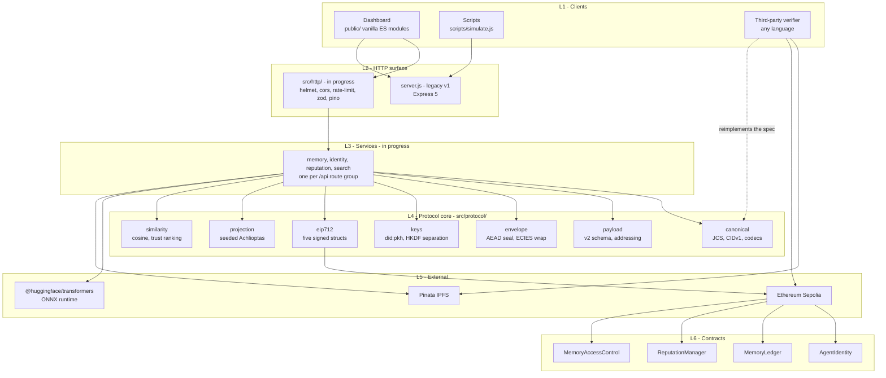
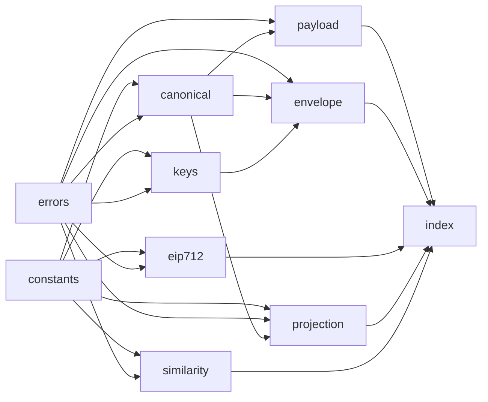
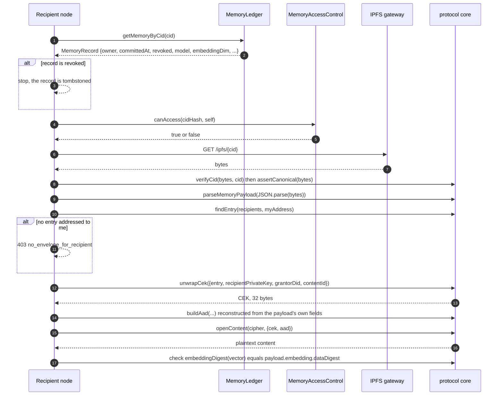
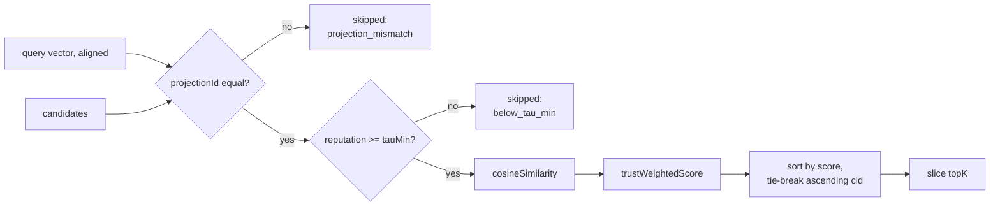
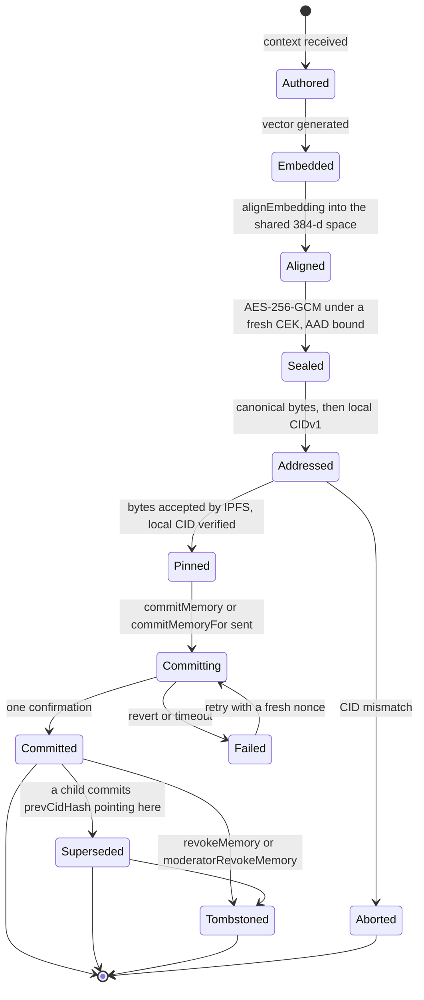
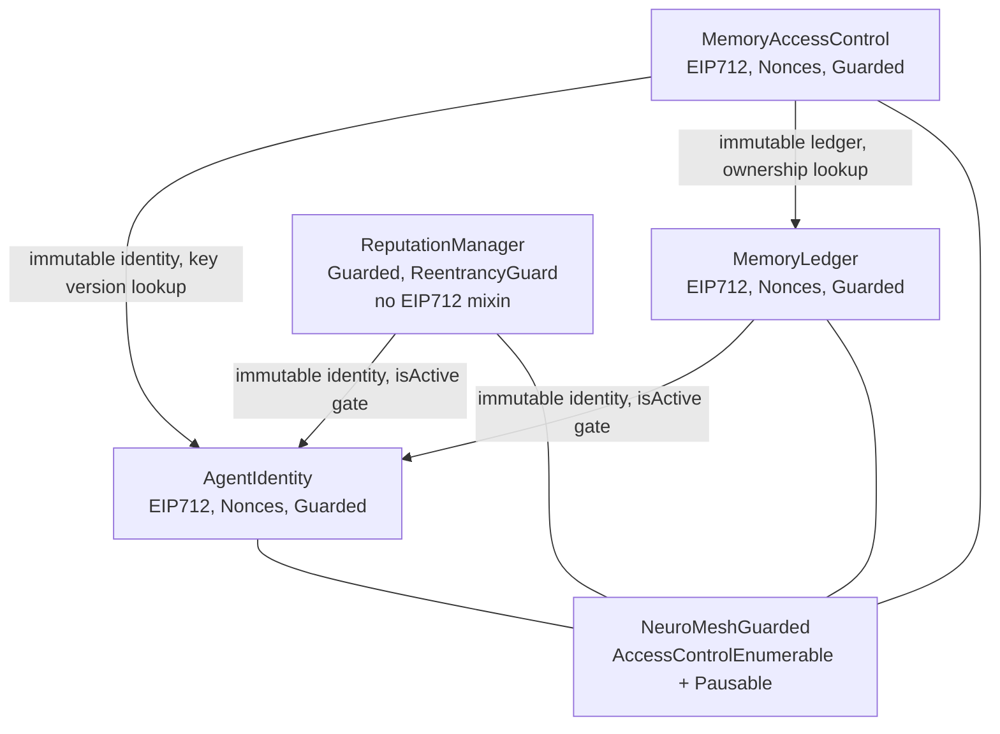
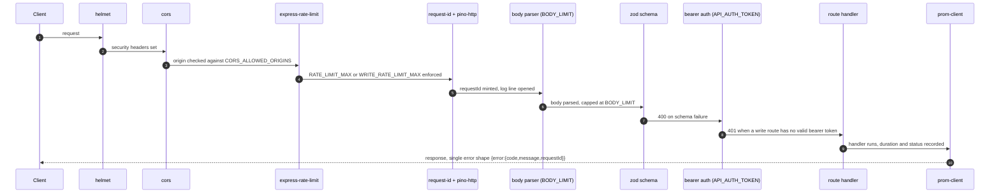

# NeuroMesh Architecture

> **Scope of this document.** It describes the system _as it exists in this repository today_.
> Every component is tagged **Implemented**, **In progress** or **Planned**, and the tag is derived
> from whether the file is present and readable, not from intent. Where a component is absent, this
> document says so instead of describing it.
>
> **Status of the system as a whole:** research prototype. Sepolia testnet only. Not audited.
> Not for mainnet value. See [SECURITY-NOTES.md](./SECURITY-NOTES.md) for the open contract findings.

---

## Contents

- [1. What the system is](#1-what-the-system-is)
- [2. Component inventory](#2-component-inventory)
- [3. Layered view](#3-layered-view)
- [4. The protocol core](#4-the-protocol-core)
- [5. Data flow: committing a memory](#5-data-flow-committing-a-memory)
- [6. Data flow: reading and decrypting a memory](#6-data-flow-reading-and-decrypting-a-memory)
- [7. Data flow: retrieval and ranking](#7-data-flow-retrieval-and-ranking)
- [8. Memory record lifecycle](#8-memory-record-lifecycle)
- [9. Contract topology](#9-contract-topology)
- [10. Request lifecycle](#10-request-lifecycle)
- [11. Failure modes](#11-failure-modes)
- [12. What is deliberately not here](#12-what-is-deliberately-not-here)

---

## 1. What the system is

NeuroMesh treats an AI agent's **memory** as the primary object of record. A memory is a piece of
context plus the embedding derived from it. The protocol makes three things true at once:

1. **The content is confidential.** The context is sealed with AES-256-GCM under a per-memory
   content-encryption key before it leaves the node. That key is wrapped separately for each
   recipient. Nothing readable is ever published.
2. **The content is addressable.** The sealed payload is canonicalised to a fixed byte string and its
   CIDv1 is computed locally, so the content identifier is a function of the bytes rather than of
   whatever a pinning service claims.
3. **Authorship is attributable.** An EIP-712 signature over the commit binds the agent, the CID
   hash, the parent CID hash, the model hash, the embedding dimension, a nonce and a deadline. The
   chain stores that binding.

What it explicitly does **not** do: it does not prove anything _about_ the content. There is no
zero-knowledge machinery anywhere in this repository — no circuit, no prover, no verifier contract,
no snarkjs/circom/halo2 dependency. The chain learns _that_ an agent committed a memory, never what
the memory says.

---

## 2. Component inventory

Every path below was checked against the working tree. Nothing is listed that does not exist.

| Path                                            | What it is                                                                          | Status                                                   |
| ----------------------------------------------- | ----------------------------------------------------------------------------------- | -------------------------------------------------------- |
| `contracts/AgentIdentity.sol`                   | Agent registry: encryption public key, key version, activity flag                   | Implemented                                              |
| `contracts/MemoryLedger.sol`                    | Append-only, tombstone-able memory proof ledger with version chains                 | Implemented                                              |
| `contracts/ReputationManager.sol`               | Endorsement/report edges, decaying evidence masses, bounded score                   | Implemented                                              |
| `contracts/MemoryAccessControl.sol`             | Per-(memory, grantee) wrapped-key publication and access predicate                  | Implemented                                              |
| `contracts/base/NeuroMeshGuarded.sol`           | Shared `AccessControlEnumerable` + `Pausable` base                                  | Implemented                                              |
| `contracts/interfaces/*.sol`                    | Four stable ABI surfaces                                                            | Implemented                                              |
| `contracts/libraries/*.sol`                     | `Limits`, `Roles`, `DecayMath`, `Pagination`, `NeuroMeshErrors`                     | Implemented                                              |
| `contracts/mocks/*.sol`                         | Decay harness, ERC-1271 wallet, reentrant endorser, reverting receiver, error probe | Implemented                                              |
| `src/protocol/*.js`                             | The ten-module protocol core (see §4)                                               | Implemented                                              |
| `test/contracts/*.spec.js`                      | 11 Hardhat spec files including fuzz invariants and a gas snapshot                  | Implemented — **223 passing**                            |
| `test/backend/protocol/*.test.js`               | 7 `node:test` suites over the protocol core                                         | Implemented                                              |
| `public/`                                       | Vanilla ES-module dashboard, five views, hand-written CSS, no bundler               | Implemented                                              |
| `scripts/simulate.js`                           | v1 multi-agent simulation and single-run latency capture                            | Implemented (legacy)                                     |
| `scripts/deploy.js`                             | Deployment script                                                                   | **Stale** — see §11 and [DEPLOYMENT.md](./DEPLOYMENT.md) |
| `scripts/generate-report.js`                    | Generates the `.docx` project report                                                | Implemented                                              |
| `server.js`                                     | HTTP server                                                                         | **Legacy v1** — see below                                |
| `lib/encryption.js`, `lib/semantic-sync.js`     | v1 crypto and projection                                                            | **Superseded** by `src/protocol/`                        |
| `Dockerfile`, `docker-compose.yml`              | Container build and single-host stack                                               | Implemented                                              |
| `.github/workflows/{ci,codeql,secret-scan}.yml` | CI, code scanning, secret scanning                                                  | Implemented                                              |

### Components that do not exist yet

These are named in the roadmap and in the dashboard's endpoint table, but there is **no file** for
them in the tree at the time of writing:

| Path                | Purpose                                                       | Status          |
| ------------------- | ------------------------------------------------------------- | --------------- |
| `src/http/`         | Express 5 app, middleware chain, zod request schemas, routers | **In progress** |
| `src/services/`     | Per-domain services: memory, identity, reputation, search     | **In progress** |
| `src/adapters/`     | Embedder, IPFS and chain adapters                             | **In progress** |
| `src/config/`       | Boot-time environment validation                              | **In progress** |
| `src/abi/`          | Generated ABIs for the v2 contracts                           | Planned         |
| `docs/openapi.json` | Machine-readable API specification                            | **In progress** |
| `scripts/verify.js` | Etherscan verification, referenced by `npm run verify`        | **Missing**     |

Until `src/http/` lands, the process started by `npm start` is the **legacy v1 `server.js`**, which
imports `lib/encryption.js` and `lib/semantic-sync.js` and speaks the _pre-rewrite_ contract ABIs. It
is not the architecture described in §3; it is what runs today. [API.md](./API.md) documents both.

---

## 3. Layered view



The dashed edge matters: a third-party verifier never talks to a NeuroMesh node. It fetches bytes
from IPFS and reads the chain, then reimplements the protocol core from its written specification.
That is the whole point of pinning the canonicalisation rules — see
[PROTOCOL.md §9](./PROTOCOL.md#9-third-party-verification-procedure).

### Cross-cutting operational rail

`pino`, `pino-http`, `prom-client`, `helmet`, `compression` and `express-rate-limit` are declared as
production dependencies in `package.json` and configured through `.env.example`. They belong to
`src/http/`, which is **in progress**. The legacy `server.js` has none of them: no helmet, no rate
limit, no structured logging, and `cors()` with no origin allowlist.

---

## 4. The protocol core

`src/protocol/` is the part of the system that is finished, tested and reimplementable. It has no
HTTP, no chain client, no filesystem access and no configuration — it is pure functions over bytes.
Consumers import from the barrel `src/protocol/index.js`, never from an individual module.

| Module          | Responsibility                                                                                        | Key exports                                                                                                                                    |
| --------------- | ----------------------------------------------------------------------------------------------------- | ---------------------------------------------------------------------------------------------------------------------------------------------- |
| `constants.js`  | Every protocol literal, plus a block mirrored verbatim from `contracts/libraries/Limits.sol`          | `PROTOCOL_VERSION`, `SPEC_HASH`, `DOMAIN_NAMES`, `LIMITS`, `RANK_*`, `PROJECTION_*`                                                            |
| `errors.js`     | Typed errors; callers branch on `error.code`, never on message text                                   | `ProtocolError` plus ten subclasses                                                                                                            |
| `canonical.js`  | RFC 8785 canonicalisation (restricted), keccak256/sha256, CIDv1, base32, base64url, float32 codecs    | `canonicalize`, `canonicalBytes`, `assertCanonical`, `cidFromBytes`, `digestFromCid`, `verifyCid`                                              |
| `payload.js`    | The canonical v2 memory payload: zod schema, deterministic serialiser, content and policy identifiers | `MemoryPayloadV2`, `parseMemoryPayload`, `serializePayloadBytes`, `addressPayload`, `computeContentId`, `computePolicyId`, `embeddingDigest`   |
| `keys.js`       | `did:pkh` formatting, and derivation of an **encryption** keypair separate from the signing key       | `toDid`, `fromDid`, `deriveEncryptionKey`, `importEncryptionKey`, `assertCompressedPublicKey`, `withKey`, `zeroize`                            |
| `envelope.js`   | Envelope encryption: AEAD content sealing with AAD binding, ECIES per-recipient CEK wrap              | `generateCek`, `buildAad`, `buildWrapAad`, `seal`, `open`, `sealContent`, `openContent`, `wrapCek`, `unwrapCek`, `findEntry`, `sortRecipients` |
| `eip712.js`     | The five signed structs, transcribed from the deployed Solidity                                       | `TYPES`, `TYPE_STRINGS`, `TYPEHASHES`, `build*`, `digest`, `digestFromParts`, `recoverTypedData`, `assertCanonicalSignature`                   |
| `projection.js` | Deterministic, seeded, versioned cross-model projection, plus SimHash                                 | `projectionSeed`, `buildProjectionMatrix`, `projectionMatrixDigest`, `alignEmbedding`, `noiseBaseline`, `simhash256`                           |
| `similarity.js` | Cosine geometry and the trust-weighted retrieval ranking                                              | `cosineSimilarity`, `calibrateTau`, `trustWeightedScore`, `rankMemories`, `semanticSearch`                                                     |
| `index.js`      | Public barrel — the single import surface                                                             | namespace re-exports plus the error classes                                                                                                    |

### Module dependency graph



There are no cycles. `constants.js` and `errors.js` are leaves; `index.js` is the only root.

**One design invariant worth stating.** `similarity.js` computes ranking in ordinary
double-precision floating point, and says so in its own header, because ranking is a presentation
concern that no two nodes must agree on bit for bit. Reputation _scores_ are consensus-critical and
are integer WAD fixed point on chain. The two arithmetics are never mixed.

---

## 5. Data flow: committing a memory

```mermaid
sequenceDiagram
  autonumber
  participant C as Client
  participant A as NeuroMesh node
  participant E as Embedder (ONNX)
  participant P as protocol core
  participant I as Pinata IPFS
  participant L as MemoryLedger (Sepolia)

  C->>A: POST /api/memories {context}
  A->>A: validate body (zod)
  A->>E: embed(context)
  E-->>A: vector[384] or vector[768]
  A->>P: alignEmbedding({embedding, targetDim: 384})
  P-->>A: {aligned, projectionId, noiseBaseline}
  A->>P: generateCek() and buildAad(agentDid, contentId, policyId, modelId, keyVersion)
  A->>P: sealContent({context, embedding}, {cek, aad})
  P-->>A: cipher {alg, iv, ct, tag}
  A->>P: wrapCek(cek) once per recipient (ECIES secp256k1)
  P-->>A: recipients[]
  A->>P: addressPayload(payload)
  P-->>A: {bytes, cid, cidDigest, payloadHash}
  A->>I: pin the exact bytes
  I-->>A: CID claimed by the service
  A->>P: verifyCid(bytes, claimedCid)
  Note over A,P: the locally computed CID wins; a mismatch aborts the commit
  A->>P: buildMemoryCommit(...) then sign EIP-712
  A->>L: commitMemory(input) or commitMemoryFor(agent, input, deadline, sig)
  L-->>A: txHash
  A->>L: wait for TX_CONFIRMATIONS
  A-->>C: 201 {cid, cidHash, txHash, blockNumber}
```

Two properties of this sequence are load-bearing.

- **The CID is computed locally before it is trusted.** `verifyCid` removes the pinning service from
  the middle of the proof chain. If Pinata returns a CID that does not address the exact bytes the
  node produced, the commit aborts rather than anchoring a hash of unknown content.
- **The AAD is built before the seal, from fields that end up in the payload.** A third party
  reconstructs the AAD from the payload's own fields; it must never trust an `aad` echo stored inside
  the payload. This is what makes the v1 cut-and-paste attack impossible — see
  [PROTOCOL.md §5.2](./PROTOCOL.md#52-additional-authenticated-data).

---

## 6. Data flow: reading and decrypting a memory



`envelope.findEntry` returns `null` rather than throwing, precisely so the caller can distinguish
"this memory was never shared with me" (`NO_ENVELOPE_FOR_RECIPIENT`) from "the envelope is corrupt or
forged" (`TAG_VERIFY_FAILED`). Collapsing the two — which the v1 `/api/decrypt` route did with a
blanket 403 — hands an attacker an ownership oracle.

**On-chain access control is advisory for confidentiality.** `MemoryAccessControl.canAccess` gates
what a _cooperating node_ will serve. It cannot un-publish an ECIES envelope that was already written
into a payload on IPFS: anyone holding the matching private key can decrypt regardless of what the
chain says afterwards. Revocation stops future grants, never past ones.

---

## 7. Data flow: retrieval and ranking

Retrieval is two hard filters followed by one score.



The score, from `src/protocol/similarity.js`:

```text
score = max(0, similarity) * (theta + (1 - theta) * tau^phi) * 2^(-ageDays / halfLife)
```

with the defaults in `src/protocol/constants.js`: `RANK_THETA = 0.2`, `RANK_PHI = 0.5`,
`RECENCY_HALFLIFE_DAYS = 180`, `TAU_MIN = 0`.

Trust-gated retrieval is **implemented**, not planned: `trustWeightedScore` is a real exported
function and `rankMemories` calls it for every surviving candidate. Two caveats, stated plainly:

- `theta = 0.2` is a **floor**, so reputation re-ranks and never gates. An agent with zero reputation
  still contributes 20% of its cosine. This is deliberate — reputation is not access control.
- `semanticSearch()` is a separate, deliberately pure-similarity variant with no trust and no recency
  term. A caller that wants trust weighting must call `rankMemories`.

The `projection_mismatch` filter is the direct fix for a defect in this repository's history: a random
projection matrix was regenerated per process, so two nodes projected into two independent subspaces
and every cross-node cosine was noise. Comparing across projection identifiers now yields a skip with
a diagnostic instead of a number.

---

## 8. Memory record lifecycle



**Tombstoning is not deletion.** `MemoryLedger` never frees a `cidHash`; a revoked record keeps its
slot so the identifier can never be re-registered by a squatter. It also means the IPFS bytes remain
retrievable by anyone who has the CID — revocation is an on-chain signal, not an unpublish.

---

## 9. Contract topology



Every inter-contract reference is `immutable` and validated at construction for both a zero address
and a non-empty `code.length`. There is no setter for any of them. A swappable identity oracle would
let an administrator retroactively legitimise arbitrary commits, so migration means deploying a new
ledger — an intentional trade-off, documented in `MemoryLedger`'s own header.

**`ReputationManager` has no `EIP712` mixin.** It has no signed entrypoint; `endorseAgent` and
`reportAgent` authorise purely from `msg.sender`. Calling `eip712Domain()` on it reverts. There is
consequently no `Endorsement` struct in `src/protocol/eip712.js`, and no gasless relayer path for
trust actions. This is a real gap, tracked as SEC-11 / NM-10.

### Roles

From `contracts/libraries/Roles.sol`, all honoured through `NeuroMeshGuarded`:

| Role                 | Powers                                           | Honoured by                           |
| -------------------- | ------------------------------------------------ | ------------------------------------- |
| `DEFAULT_ADMIN_ROLE` | Admin of every role below; grant and revoke      | all four                              |
| `PAUSER_ROLE`        | `pause()` / `unpause()`                          | all four                              |
| `PARAM_ADMIN_ROLE`   | Reputation parameter setters                     | `ReputationManager`                   |
| `REGISTRAR_ROLE`     | `adminSetActive` — suspend or reinstate an agent | `AgentIdentity`                       |
| `MODERATOR_ROLE`     | `moderatorRevokeMemory`, `moderatorRevokeAccess` | `MemoryLedger`, `MemoryAccessControl` |
| `SLASHER_ROLE`       | `slashEndorsement`                               | `ReputationManager`                   |
| `TREASURER_ROLE`     | `withdrawTreasury`                               | `ReputationManager`                   |

Pause guards entrypoints that create new protocol state. It is deliberately **not** applied to
`AgentIdentity.deactivate` or `ReputationManager.claimStake`, which are user-protective exits, nor to
moderation and role administration. Two of those exemptions are currently incomplete — see
[SECURITY-NOTES.md](./SECURITY-NOTES.md) SEC-08.

---

## 10. Request lifecycle

The middleware chain below is the **target** design for `src/http/`, reconstructed from the
dependencies declared in `package.json` and the variables defined in `.env.example`. It is not yet
running; the legacy `server.js` has `cors()` and `express.json()` and nothing else.



**Timeouts.** `public/js/api.js` sets per-class client deadlines, with 90 s for a commit, justified in
its own comment by this repository's own measurement that end-to-end latency reached 24 s. Server
side the corresponding budgets are `TX_TIMEOUT_MS` (default 120000) and `IPFS_TIMEOUT_MS`
(default 30000).

---

## 11. Failure modes

Ordered roughly by how likely each is to bite you first.

| #   | Failure                               | Trigger                                                                                                                                                                                                      | Observable effect                                                                                                  | Handling today                                                                                                                                                   |
| --- | ------------------------------------- | ------------------------------------------------------------------------------------------------------------------------------------------------------------------------------------------------------------ | ------------------------------------------------------------------------------------------------------------------ | ---------------------------------------------------------------------------------------------------------------------------------------------------------------- |
| 1   | **Deployed ABI mismatch**             | `contract-addresses.json` holds the _pre-rewrite_ v1 Sepolia contracts; the v2 suite has different signatures                                                                                                | Every v2 write call reverts or decodes as garbage                                                                  | Documented. `docs/V2.1-HARDENING-PLAN.md` records that the backend reports `contractsCompatible: false` and serves read-only routes. **A redeploy is required.** |
| 2   | **`scripts/deploy.js` is stale**      | It calls `AgentIdentity.deploy()`, `MemoryLedger.deploy()` and `ReputationManager.deploy(identityAddress)`, none of which match the v2 constructors, and it never deploys `MemoryAccessControl`              | `npm run deploy:sepolia` fails at the first factory call                                                           | **Unfixed.** [DEPLOYMENT.md](./DEPLOYMENT.md) gives the correct constructor arguments.                                                                           |
| 3   | **`npm run verify` has no script**    | `package.json` maps it to `hardhat run scripts/verify.js`; that file does not exist                                                                                                                          | `Cannot find module scripts/verify.js`                                                                             | **Unfixed.** Use `npx hardhat verify` directly.                                                                                                                  |
| 4   | **Model cold load**                   | First request after boot with `MODEL_PRELOAD=false`, or a cold container with no cache volume                                                                                                                | A ~90 MB download, then 197 ms (MiniLM) or 666 ms (DistilRoBERTa) of initialisation                                | `MODEL_PRELOAD=true` by default; the Docker healthcheck `start-period` is 180 s; compose mounts a cache volume                                                   |
| 5   | **IPFS pin failure or timeout**       | Pinata down, JWT expired, or `IPFS_TIMEOUT_MS` exceeded                                                                                                                                                      | The commit aborts before any transaction is sent                                                                   | Correct ordering: nothing is ever anchored to a CID that was never pinned                                                                                        |
| 6   | **CID mismatch**                      | The pinning service returns a CID that does not address the submitted bytes                                                                                                                                  | `CidMismatchError` (`CID_MISMATCH`), commit aborts                                                                 | Implemented in `canonical.verifyCid`                                                                                                                             |
| 7   | **Chain inclusion jitter**            | Public Sepolia                                                                                                                                                                                               | 7.0 s to 21.3 s to one confirmation, median 16.2 s (n=5, this repository's own run)                                | This is testnet behaviour, not a NeuroMesh property. See [BENCHMARKS.md](./BENCHMARKS.md)                                                                        |
| 8   | **Commit reverts**                    | `AgentInactive`, `MemoryAlreadyExists`, `ParentNotFound`, `ParentNotOwnedByAgent`, `ParentRevoked`, `SelfReferentialParent`, `InvalidEmbeddingDim`, `SignatureExpired`, `DeadlineTooFar`, `InvalidSignature` | A named custom error in the revert data                                                                            | 39 custom errors in `contracts/libraries/NeuroMeshErrors.sol`; two of them (`EmptyField`, `GrantExpired`) are **unreachable** — SEC-14                           |
| 9   | **CID front-running**                 | An observer sees a CID in the mempool or on a public pin list and commits it first                                                                                                                           | The squatter permanently owns the record; the author is locked out by `MemoryAlreadyExists`, with no recovery path | **Unmitigated.** Critical finding SEC-01 / NM-01                                                                                                                 |
| 10  | **Tag verification failure**          | Wrong CEK, a tampered block, or a ciphertext lifted from another agent's payload                                                                                                                             | `DecryptionError` with code `TAG_VERIFY_FAILED`                                                                    | Implemented, and deliberately distinct from `NO_ENVELOPE_FOR_RECIPIENT`                                                                                          |
| 11  | **Projection mismatch at query time** | A candidate aligned under a different `projectionId`                                                                                                                                                         | The candidate is skipped with a diagnostic, never scored                                                           | Implemented in `similarity.rankMemories`                                                                                                                         |
| 12  | **Dimension expansion request**       | Attempting to align a 384-d vector into a 768-d space                                                                                                                                                        | `DimensionMismatchError` with an explanatory message                                                               | Implemented; the v1 zero-padding path was removed deliberately                                                                                                   |
| 13  | **Payload over 1 MiB**                | Oversized context or embedding                                                                                                                                                                               | `PayloadTooLargeError`                                                                                             | Enforced in `canonical.canonicalBytes`                                                                                                                           |
| 14  | **Reputation decay defeated**         | Anyone calls `settle(agent)` more often than once per `halfLife/16` — 5.625 days at the default                                                                                                              | The agent's masses never decay                                                                                     | **Unmitigated.** SEC-04 / NM-04                                                                                                                                  |
| 15  | **Free permanent report**             | One throwaway registered address calls `reportAgent`                                                                                                                                                         | The target loses `isTrusted` permanently; decay does not heal it, because the ratio is decay-invariant             | **Unmitigated.** SEC-03 / NM-03                                                                                                                                  |
| 16  | **musl base image**                   | Building on `node:22-alpine`                                                                                                                                                                                 | `npm ci` _succeeds_, then the first import fails with `Error loading shared library ld-linux-x86-64.so.2`          | Pinned to `node:22-bookworm-slim`; the reason is written into the Dockerfile so nobody "optimises" it back                                                       |

---

## 12. What is deliberately not here

Naming the absences is part of the architecture.

- **No zero-knowledge layer.** No circuit, prover, verifier contract, or ZK dependency.
  Confidentiality comes from symmetric encryption, which is a different property from zero knowledge.
- **No cross-model alignment.** The projection is _deterministic and versioned_, which buys
  reproducibility. It does not make two independently trained encoders comparable —
  Johnson–Lindenstrauss is a within-space guarantee. `projection.noiseBaseline` exists so every
  reported similarity can be read against the null. See
  [PROTOCOL.md §7](./PROTOCOL.md#7-cross-model-projection).
- **No persistent vector index.** There is no index module in the tree. Retrieval operates over a
  candidate list the caller supplies.
- **No federation.** Nodes do not discover or gossip with one another.
- **No token, no incentive layer, no economic security.** `endorsementStakeWei` defaults to `0`, and
  the stake mechanism that does exist is front-runnable (SEC-02).
- **No relayer path for trust actions.** `ReputationManager` has no meta-transaction entrypoint, so
  an agent with no ETH can register, commit and grant access but cannot endorse or report.
- **No signed evidence edges.** No `weight`, `reasonCode`, `contextDigest` or `evidenceDigest` on
  chain, so a reproducible off-chain trust computation cannot be driven from the emitted events.

---

## See also

- [PROTOCOL.md](./PROTOCOL.md) — the normative wire format and cryptographic construction
- [API.md](./API.md) — the HTTP surface, current and target
- [CONFIGURATION.md](./CONFIGURATION.md) — every environment variable
- [DEPLOYMENT.md](./DEPLOYMENT.md) — local, Docker, Spaces, Sepolia, and the ops runbook
- [BENCHMARKS.md](./BENCHMARKS.md) — measured statistics and methodology
- [THREAT_MODEL.md](./THREAT_MODEL.md) — adversaries, mitigations, residual risk
- [SECURITY-NOTES.md](./SECURITY-NOTES.md) — the open contract findings
- [ROADMAP.md](./ROADMAP.md) — what is next
