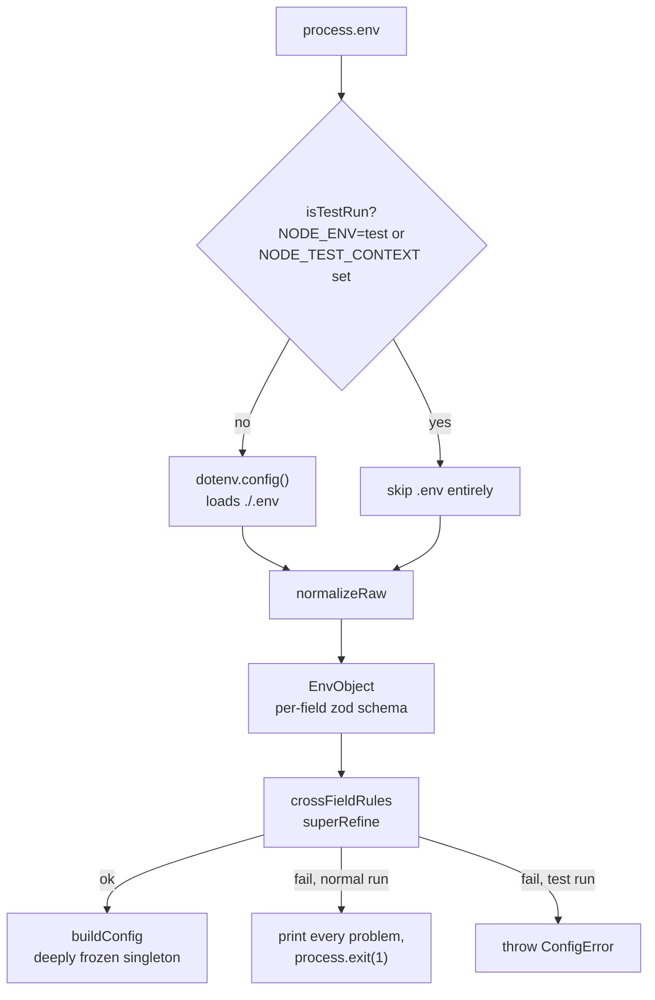

# Configuration

Every environment variable NeuroMesh recognises, with its type, whether it is required, its default
and an example.

**Source of truth:** `src/config/env.js`. That file is the only place in the repository that reads
`process.env`. Everything below was transcribed from its zod schema (`EnvObject`) and its cross-field
rules (`crossFieldRules`). `.env.example` is the operator-facing template and is kept in step; where
the two differ, **the schema wins** and the difference is called out in [§7](#7-known-drift).

---

## Contents

- [1. How configuration is loaded](#1-how-configuration-is-loaded)
- [2. Value formats](#2-value-formats)
- [3. Variable reference](#3-variable-reference)
- [4. Cross-field rules that block boot](#4-cross-field-rules-that-block-boot)
- [5. Secrets](#5-secrets)
- [6. Derived configuration](#6-derived-configuration)
- [7. Known drift](#7-known-drift)
- [8. Worked profiles](#8-worked-profiles)

---

## 1. How configuration is loaded



Four properties of this pipeline are deliberate and worth knowing:

- **One parse, once, before anything else happens.** v1 read the environment ad hoc inside the
  `app.listen` callback, so a fresh clone bound the port and _then_ threw
  `TypeError: Cannot read properties of undefined`, answering 200 on status with
  `agentAddress: "Loading..."` forever and 500 on every write.
- **Failure reports every problem at once**, by path and message. **Values are never printed** — for
  _all_ variables, not just secrets, because a "must be 32 bytes of hex" message that helpfully
  echoes what it received is exactly how a key ends up in a CI log.
- **An empty string is treated as absent.** `.env` files are full of `PRIVATE_KEY=`, and
  `z.coerce.number()` happily turns `''` into `0`, which would silently configure a zero timeout
  rather than reporting a missing value.
- **A test run never loads `.env`.** The repository's real `.env` holds a funded Sepolia key and a
  Pinata JWT; a unit test must never see either. `SKIP_DOTENV=1` is the explicit escape hatch for any
  other context wanting the same guarantee.

### Environment-dependent defaults

| Variable                       | Default when `NODE_ENV=test`               | Default otherwise |
| ------------------------------ | ------------------------------------------ | ----------------- |
| `NODE_ENV`                     | `test` (inferred from `NODE_TEST_CONTEXT`) | `development`     |
| `NEUROMESH_EMBEDDING_PROVIDER` | `mock`                                     | `local`           |
| `LOG_LEVEL`                    | `silent`                                   | `info`            |
| `LOG_PRETTY`                   | `false` in production, `true` elsewhere    | same rule         |

---

## 2. Value formats

| Format           | Accepted input                                                                               | Normalised to       |
| ---------------- | -------------------------------------------------------------------------------------------- | ------------------- |
| **boolish**      | `1`, `true`, `yes`, `on` / `0`, `false`, `no`, `off` — case-insensitive; also a real boolean | `boolean`           |
| **csv**          | comma-separated string, or an array; entries trimmed, empties dropped                        | `string[]`          |
| **hex32**        | 64 hex characters, `0x` prefix optional                                                      | lower-case `0x…`    |
| **evmAddress**   | any EVM address; **the EIP-55 checksum is validated**, which catches typos                   | checksummed address |
| **int(min,max)** | numeric string, coerced                                                                      | bounded integer     |
| **url**          | absolute URL                                                                                 | string              |

---

## 3. Variable reference

`Req?` column: **yes** = boot fails without it; **cond** = required only under the condition given;
**no** = optional with a default.

### 3.1 Process

| Variable              | Type                                                              | Req? | Default                                        | Example      | Purpose                                                                                                                           |
| --------------------- | ----------------------------------------------------------------- | ---- | ---------------------------------------------- | ------------ | --------------------------------------------------------------------------------------------------------------------------------- |
| `NODE_ENV`            | enum `development` \| `test` \| `production`                      | no   | `development`                                  | `production` | Execution mode. Drives four other defaults and one hard rule (§4.1)                                                               |
| `PORT`                | int 1–65535                                                       | no   | `7860`                                         | `7860`       | HTTP listen port. 7860 is the HuggingFace Spaces convention                                                                       |
| `HOST`                | string                                                            | no   | `127.0.0.1`                                    | `0.0.0.0`    | Bind interface. **Defaults to loopback on purpose** — v1 bound the wildcard, which put a wallet-spending API on the LAN. See §4.3 |
| `LOG_LEVEL`           | enum `fatal`\|`error`\|`warn`\|`info`\|`debug`\|`trace`\|`silent` | no   | `info` (`silent` in test)                      | `debug`      | pino level                                                                                                                        |
| `LOG_PRETTY`          | boolish                                                           | no   | `true`, but `false` when `NODE_ENV=production` | `false`      | Human-readable output via `pino-pretty` (a devDependency). Production emits newline-delimited JSON                                |
| `SHUTDOWN_TIMEOUT_MS` | int 0–600000                                                      | no   | `10000`                                        | `30000`      | Graceful drain budget on `SIGTERM` before in-flight requests are dropped                                                          |
| `GIT_COMMIT`          | string                                                            | no   | `unknown`                                      | `c7e3cfb`    | Build fingerprint surfaced by the status route                                                                                    |

### 3.2 HTTP surface

| Variable               | Type              | Req? | Default                 | Example                 | Purpose                                                                                                         |
| ---------------------- | ----------------- | ---- | ----------------------- | ----------------------- | --------------------------------------------------------------------------------------------------------------- |
| `BODY_LIMIT`           | byte-size string  | no   | `256kb`                 | `1mb`                   | Maximum accepted request body                                                                                   |
| `TRUST_PROXY`          | boolish \| string | no   | `false`                 | `loopback`              | Express trust-proxy setting. Set this correctly behind a reverse proxy or the rate limiter keys on the wrong IP |
| `CORS_ALLOWED_ORIGINS` | csv               | no   | `[]` (same-origin only) | `http://localhost:7860` | Exact allowed browser origins. **`*` is rejected** — see §4.2                                                   |

### 3.3 Rate limiting

| Variable                 | Type             | Req? | Default | Example | Purpose                                         |
| ------------------------ | ---------------- | ---- | ------- | ------- | ----------------------------------------------- |
| `RATE_LIMIT_WINDOW_MS`   | int 1000–3600000 | no   | `60000` | `60000` | Sliding window                                  |
| `RATE_LIMIT_MAX`         | int 1–100000     | no   | `60`    | `120`   | Read requests per window per IP                 |
| `WRITE_RATE_LIMIT_MAX`   | int 1–100000     | no   | `10`    | `5`     | Tighter cap for routes that spend gas           |
| `SEARCH_RATE_LIMIT_MAX`  | int 1–100000     | no   | `20`    | `40`    | Cap for search, which runs an embedding         |
| `DECRYPT_RATE_LIMIT_MAX` | int 1–100000     | no   | `5`     | `5`     | Cap for decrypt, the most abuse-sensitive route |

### 3.4 Authentication

| Variable          | Type                     | Req?     | Default | Example                       | Purpose                                                                                                                                                          |
| ----------------- | ------------------------ | -------- | ------- | ----------------------------- | ---------------------------------------------------------------------------------------------------------------------------------------------------------------- |
| `API_AUTH_TOKEN`  | string, **min 32 chars** | **cond** | none    | `openssl rand -hex 32` output | Bearer token gating every mutating route. **Required when `NODE_ENV=production`, and required whenever `HOST=0.0.0.0`.** A repeated single character is rejected |
| `METRICS_ENABLED` | boolish                  | no       | `true`  | `false`                       | Whether `/metrics` is served                                                                                                                                     |
| `METRICS_TOKEN`   | string, min 16 chars     | no       | none    | `openssl rand -hex 16` output | Optional bearer token for `/metrics`                                                                                                                             |

### 3.5 Chain

| Variable                         | Type             | Req?     | Default                        | Example                          | Purpose                                                                                                                                                  |
| -------------------------------- | ---------------- | -------- | ------------------------------ | -------------------------------- | -------------------------------------------------------------------------------------------------------------------------------------------------------- |
| `SEPOLIA_RPC_URL`                | absolute URL     | **cond** | none                           | `https://sepolia.infura.io/v3/…` | JSON-RPC endpoint. Absent ⇒ the node is read-only (§6). Use a keyed provider; public `rpc.sepolia.org` is rate limited and makes deploys look like hangs |
| `RPC_URLS`                       | csv of URLs      | no       | none                           | `https://a…,https://b…`          | Multiple endpoints. **Takes precedence over `SEPOLIA_RPC_URL` when non-empty**                                                                           |
| `CHAIN_ID`                       | int              | no       | `11155111`                     | `11155111`                       | Guards against writing to the wrong network                                                                                                              |
| `PRIVATE_KEY`                    | hex32            | **cond** | none                           | `0x` + 64 hex                    | Node signing key. Absent ⇒ read-only node. **Testnet keys only**                                                                                         |
| `CONTRACT_ADDRESSES_PATH`        | string           | no       | `./contract-addresses.json`    | `./deployments/11155111.json`    | Where deployed addresses are read from                                                                                                                   |
| `CONTRACT_AGENT_IDENTITY`        | evmAddress       | no       | none                           | `0xD4F9…A2ad`                    | Per-contract override                                                                                                                                    |
| `CONTRACT_MEMORY_LEDGER`         | evmAddress       | no       | none                           | `0x1070…940Fb`                   | Per-contract override                                                                                                                                    |
| `CONTRACT_REPUTATION_MANAGER`    | evmAddress       | no       | none                           | `0x8E56…35ac`                    | Per-contract override                                                                                                                                    |
| `CONTRACT_MEMORY_ACCESS_CONTROL` | evmAddress       | no       | none                           | `0x…`                            | Per-contract override. **No v1 deployment exists for this contract**                                                                                     |
| `TX_CONFIRMATIONS`               | int 1–64         | no       | `1`                            | `2`                              | Confirmations before a transaction is treated as final                                                                                                   |
| `TX_TIMEOUT_MS`                  | int 1000–3600000 | no       | `120000`                       | `180000`                         | Per-transaction timeout                                                                                                                                  |
| `TX_QUEUE_MAX`                   | int 1–10000      | no       | `32`                           | `64`                             | Bound on queued outbound transactions                                                                                                                    |
| `GAS_PRICE_MULTIPLIER`           | float 1–10       | no       | `1.2`                          | `1.5`                            | Multiplier on the estimated gas price                                                                                                                    |
| `EXPLORER_BASE_URL`              | absolute URL     | no       | `https://sepolia.etherscan.io` | same                             | Used to build explorer links                                                                                                                             |

### 3.6 IPFS

| Variable           | Type              | Req?     | Default                             | Example       | Purpose                                                                            |
| ------------------ | ----------------- | -------- | ----------------------------------- | ------------- | ---------------------------------------------------------------------------------- |
| `PINATA_JWT`       | string, min 1     | **cond** | none                                | `eyJhbGciOi…` | Pinata bearer token. Absent ⇒ IPFS is disabled and commits cannot complete         |
| `PINATA_API_URL`   | absolute URL      | no       | `https://api.pinata.cloud`          | same          | Pinning API base                                                                   |
| `IPFS_GATEWAY_URL` | absolute URL      | no       | `https://gateway.pinata.cloud/ipfs` | same          | Gateway used for server-side reads                                                 |
| `IPFS_TIMEOUT_MS`  | int 1000–600000   | no       | `30000`                             | `45000`       | Pin and fetch timeout                                                              |
| `IPFS_MAX_BYTES`   | int 1024–16777216 | no       | `1048576`                           | `1048576`     | Maximum payload size accepted from a gateway. Matches the protocol's own 1 MiB cap |

### 3.7 Cryptography

| Variable                 | Type        | Req? | Default | Example                       | Purpose                                                                                                                                                                                                                                                                 |
| ------------------------ | ----------- | ---- | ------- | ----------------------------- | ----------------------------------------------------------------------------------------------------------------------------------------------------------------------------------------------------------------------------------------------------------------------- |
| `MEMORY_ENCRYPTION_KEY`  | hex32       | no   | none    | `openssl rand -hex 32` output | An explicitly supplied encryption key. **When absent, the encryption keypair is derived from the wallet key by HKDF** — still key separation, because the derivation is one-way and domain-separated (see [PROTOCOL.md §6](./PROTOCOL.md#6-key-hierarchy-and-identity)) |
| `ENCRYPTION_KEY_VERSION` | int 1–65535 | no   | `1`     | `2`                           | Key version. Bumping it produces an entirely unrelated keypair and must be published on chain with `AgentIdentity.rotateKey`                                                                                                                                            |

> **`MEMORY_ENCRYPTION_KEY` must never equal `PRIVATE_KEY`.** Boot fails with a key-separation
> violation if they match. See §4.4.

### 3.8 Embeddings

| Variable                       | Type                   | Req? | Default                       | Example                    | Purpose                                                                                                                 |
| ------------------------------ | ---------------------- | ---- | ----------------------------- | -------------------------- | ----------------------------------------------------------------------------------------------------------------------- |
| `NEUROMESH_EMBEDDING_PROVIDER` | enum `local` \| `mock` | no   | `local` (`mock` in test)      | `mock`                     | `mock` avoids the ~90 MB model download. CI uses it                                                                     |
| `EMBEDDING_MODEL`              | string                 | no   | `Xenova/all-MiniLM-L6-v2`     | same                       | Primary model, 384-d                                                                                                    |
| `EMBEDDING_MODEL_ALT`          | string                 | no   | `Xenova/all-distilroberta-v1` | same                       | Secondary model, 768-d, projected to 384                                                                                |
| `MODEL_PRELOAD`                | boolish                | no   | `true`                        | `false`                    | Load at boot rather than on first request                                                                               |
| `MODEL_LOAD_TIMEOUT_MS`        | int 1000–3600000       | no   | `300000`                      | `600000`                   | Cold-load budget, generous because of the download                                                                      |
| `EMBED_TIMEOUT_MS`             | int 100–600000         | no   | `30000`                       | `10000`                    | Per-inference timeout                                                                                                   |
| `EMBED_QUEUE_MAX`              | int 1–10000            | no   | `64`                          | `128`                      | Bound on queued embedding requests                                                                                      |
| `TRANSFORMERS_CACHE`           | path                   | no   | `./.cache/transformers`       | `/app/.cache/transformers` | On-disk model cache. Mount a volume here in production                                                                  |
| `MAX_CONTEXT_CHARS`            | int 1–1000000          | no   | `8000`                        | `4000`                     | Maximum accepted context length                                                                                         |
| `MAX_REASON_CHARS`             | int 1–10000            | no   | `200`                         | `128`                      | Maximum endorsement/report reason length. The contracts cap the on-chain value at 128 bytes (`Limits.MAX_REASON_BYTES`) |

### 3.9 Semantic layer

| Variable                | Type           | Req? | Default                         | Example                     | Purpose                                                                                                                                         |
| ----------------------- | -------------- | ---- | ------------------------------- | --------------------------- | ----------------------------------------------------------------------------------------------------------------------------------------------- |
| `ALIGNMENT_BUNDLE_PATH` | path           | no   | none                            | `./alignment/bundle.json`   | **Planned** — a learned cross-model alignment bundle. No bundle format is implemented today; the projection is the deterministic Achlioptas one |
| `ANCHOR_SET_PATH`       | path           | no   | none                            | `./alignment/anchors.jsonl` | **Planned** — anchor corpus for relative representations                                                                                        |
| `SEMANTIC_INDEX_PATH`   | path           | no   | `./.cache/semantic-index.jsonl` | same                        | Local index file                                                                                                                                |
| `SEMANTIC_INDEX_MAX`    | int 1–10000000 | no   | `10000`                         | `50000`                     | Maximum indexed vectors                                                                                                                         |

### 3.10 Jobs, events, features

| Variable                  | Type               | Req? | Default                     | Example   | Purpose                                                 |
| ------------------------- | ------------------ | ---- | --------------------------- | --------- | ------------------------------------------------------- |
| `JOB_TTL_MS`              | int 1000–604800000 | no   | `3600000` (1 h)             | `7200000` | How long a completed async job record is retained       |
| `JOB_MAX`                 | int 1–1000000      | no   | `500`                       | `1000`    | Maximum retained job records                            |
| `IDEMPOTENCY_TTL_MS`      | int 1000–604800000 | no   | `86400000` (24 h)           | `3600000` | Idempotency-key retention                               |
| `SSE_MAX_CLIENTS`         | int 1–100000       | no   | `100`                       | `50`      | Concurrent server-sent-event subscribers                |
| `SSE_HEARTBEAT_MS`        | int 1000–600000    | no   | `15000`                     | `30000`   | Keepalive interval                                      |
| `ENABLE_LEGACY_ROUTES`    | boolish            | no   | `false`                     | `true`    | Serves the unversioned v1 route aliases. Off by default |
| `SIMULATION_RESULTS_PATH` | path               | no   | `./simulation-results.json` | same      | Where benchmark output is read from                     |

### 3.11 Tooling — read by Hardhat and the scripts, **not** by `src/config/env.js`

These are consumed directly by `hardhat.config.js`, the Hardhat toolbox or `scripts/`, so they do
**not** appear in the application schema and are not validated at boot.

| Variable                 | Type    | Req? | Default     | Purpose                                                  |
| ------------------------ | ------- | ---- | ----------- | -------------------------------------------------------- |
| `ETHERSCAN_API_KEY`      | string  | cond | none        | Required for `npx hardhat verify`                        |
| `REPORT_GAS`             | boolish | no   | `false`     | Hardhat gas report during contract tests                 |
| `COINMARKETCAP_API_KEY`  | string  | no   | none        | Prices gas in fiat for the gas reporter                  |
| `SIMULATION_AGENT_COUNT` | int     | no   | `3`         | Synthetic agents created by `npm run simulate`           |
| `REPORT_OUTPUT_DIR`      | path    | no   | `./reports` | Generated report output directory                        |
| `SKIP_DOTENV`            | `1`     | no   | unset       | Escape hatch: never load `.env`, even outside a test run |
| `HEALTHCHECK_PATH`       | path    | no   | `/healthz`  | Read by the Docker `HEALTHCHECK`, not by the app         |

---

## 4. Cross-field rules that block boot

Each of these exists because of a specific way the service can be misconfigured into being
_dangerous_ rather than merely broken. All five are in `crossFieldRules`.

### 4.1 Production requires a token

```text
NODE_ENV=production and API_AUTH_TOKEN unset
  -> "is required in production - every mutating route is gated on it."
```

A production node with no token is an open, wallet-spending API.

### 4.2 `*` is never an allowlist

```text
CORS_ALLOWED_ORIGINS contains "*"
  -> "must be an explicit list of origins; '*' is never accepted."
```

v1 used a bare `cors()`, which is how a page the operator merely _visited_ could drive
`POST /api/memory` and drain the wallet. Leave the list empty for same-origin only.

### 4.3 Wildcard bind requires a token

```text
HOST=0.0.0.0 and API_AUTH_TOKEN unset
  -> "binds every interface, which requires API_AUTH_TOKEN to be set."
```

This is why the Docker image and `docker-compose.yml` set `HOST=0.0.0.0` _and_ why compose publishes
on `127.0.0.1:7860` rather than `0.0.0.0:7860`.

### 4.4 Key separation

```text
MEMORY_ENCRYPTION_KEY == PRIVATE_KEY
  -> "key separation violation: the memory encryption key MUST NOT equal the chain signing key."
```

The whole point of the envelope rewrite is that leaking the memory key must not cost signing
authority, and vice versa.

### 4.5 Trivial tokens

```text
API_AUTH_TOKEN matching /^(\w)\1*$/    (a repeated single character)
  -> "must not be a repeated single character."
```

A token short enough to guess is worse than no token, because it looks like security.

### Not an error: a read-only node

A signer with nowhere to send transactions is **not** a misconfiguration. Missing `PRIVATE_KEY` or
missing RPC URLs produces a read-only node, surfaced as a derived flag rather than a boot failure —
see §6.

---

## 5. Secrets

`SECRET_KEYS` in `src/config/env.js` names every variable whose value must never be printed, logged,
serialised into a status response, or included in an error:

```text
PRIVATE_KEY   PINATA_JWT   API_AUTH_TOKEN   MEMORY_ENCRYPTION_KEY
METRICS_TOKEN   ETHERSCAN_API_KEY   COINMARKETCAP_API_KEY
```

Three mechanisms enforce this:

1. The logger builds its redaction list from `SECRET_KEYS`.
2. `redactEnv(env)` returns a copy with each secret replaced by `[redacted]`.
3. In the derived configuration, secrets are attached with `defineSecret`, so they do not appear in
   `Object.keys`, in `JSON.stringify`, or in a structured log line that serialised the object whole.
   `publicConfig()` asserts that no secret value appears in its own JSON output.

### Operational rules

- **Never commit `.env`.** It is gitignored and must stay that way. Verify before every push:
  ```bash
  git check-ignore -v .env && git ls-files .env
  ```
  The first must print a `.gitignore` rule; the second must print nothing.
- If `.env` was ever committed, treat **both** the wallet and the Pinata JWT as compromised: rotate
  the JWT, sweep the wallet, and purge history with `git filter-repo` before pushing.
- **Never pass a secret as a Docker `ARG` or `ENV`.** Both are permanently visible in
  `docker history`. Secrets are runtime-only: `--env-file`, `-e`, or compose. The Dockerfile's
  builder stage fails the build loudly if `.env` reaches the build context.
- CI is hermetic by construction: no job in `.github/workflows/ci.yml` consumes a repository secret,
  and two jobs assert that fact so a later change fails loudly.

---

## 6. Derived configuration

`src/config/index.js` turns the validated environment into a **deeply frozen** configuration object,
which is the only config surface services import. The derived booleans everything branches on:

| Flag                              | Derivation                             | Meaning                                                   |
| --------------------------------- | -------------------------------------- | --------------------------------------------------------- |
| `isProduction`                    | `NODE_ENV === 'production'`            | —                                                         |
| `isTest`                          | `NODE_ENV === 'test'`                  | —                                                         |
| `signer.configured` (`hasSigner`) | `Boolean(PRIVATE_KEY)`                 | A signing key is present                                  |
| `signer.readOnly`                 | `!hasSigner \|\| rpcUrls.length === 0` | The node cannot write to chain                            |
| `features.write`                  | `!readOnly`                            | Mutating routes are enabled                               |
| `features.metrics`                | `METRICS_ENABLED`                      | `/metrics` is served                                      |
| `features.legacyRoutes`           | `ENABLE_LEGACY_ROUTES`                 | Unversioned v1 aliases are mounted                        |
| `ipfs.enabled`                    | `Boolean(PINATA_JWT)`                  | Pinning is possible                                       |
| `crypto.deriveFromWallet`         | `!MEMORY_ENCRYPTION_KEY`               | Derive the encryption keypair by HKDF from the wallet key |
| `security.apiTokenConfigured`     | `Boolean(API_AUTH_TOKEN)`              | —                                                         |

`rpcUrls` resolves as: `RPC_URLS` if non-empty, else `[SEPOLIA_RPC_URL]` if set, else `[]`.

Contract addresses resolve from the per-contract `CONTRACT_*` overrides first, then from
`CONTRACT_ADDRESSES_PATH`; the resulting `source` string is reported by the status route so an
operator can see where the addresses came from.

### Contract compatibility

`src/abi/` carries `EXPECTED_TYPEHASHES`, `DEPLOYED_BYTECODE_HASHES`, `DEPLOYED_BYTECODE_SIZES` and
`SUPPORTS_EIP712`, generated by `node scripts/gen-abi.js` from `artifacts/contracts/`. No ABI
fragment is hand-written anywhere. `node scripts/gen-abi.js --check` fails when the tree and the
artifacts disagree.

The addresses currently in `contract-addresses.json` point at **pre-rewrite v1 contracts whose ABI
does not match**. That is treated as a _degraded_ state, not a crash: read-only routes and the
dashboard keep working while `/readyz` and the status route report
`chain: { reachable: true, contractsCompatible: false }`. See [DEPLOYMENT.md](./DEPLOYMENT.md).

---

## 7. Known drift

`.env.example` and the schema in `src/config/env.js` do not match everywhere. The schema is
authoritative; these differences are documented rather than papered over.

| Variable                                                                                                                                                                                                                                                                                                                                                                                                                                                                                             | In `.env.example`                                        | In the schema                                  | Resolution                                                                                                                             |
| ---------------------------------------------------------------------------------------------------------------------------------------------------------------------------------------------------------------------------------------------------------------------------------------------------------------------------------------------------------------------------------------------------------------------------------------------------------------------------------------------------- | -------------------------------------------------------- | ---------------------------------------------- | -------------------------------------------------------------------------------------------------------------------------------------- |
| `CORS_ORIGINS`                                                                                                                                                                                                                                                                                                                                                                                                                                                                                       | present, described as an alias                           | **not recognised**                             | Use `CORS_ALLOWED_ORIGINS`. Setting `CORS_ORIGINS` alone leaves the allowlist empty                                                    |
| `API_KEY`                                                                                                                                                                                                                                                                                                                                                                                                                                                                                            | present, described as an alias                           | **not recognised**                             | Use `API_AUTH_TOKEN`. Setting `API_KEY` alone leaves a production node unbootable and a `0.0.0.0` bind rejected                        |
| `HOST`                                                                                                                                                                                                                                                                                                                                                                                                                                                                                               | documented default `127.0.0.1`, example sets `127.0.0.1` | default `127.0.0.1`                            | Agrees                                                                                                                                 |
| `PBKDF2_ITERATIONS`                                                                                                                                                                                                                                                                                                                                                                                                                                                                                  | present, default `210000`                                | **not recognised**                             | Vestigial. The v2 protocol uses HKDF-SHA256, not PBKDF2. Only the legacy `lib/encryption.js` path ever read anything like it           |
| `MEMORY_ENCRYPTION_KEY`                                                                                                                                                                                                                                                                                                                                                                                                                                                                              | described as "REQUIRED for encrypted memories"           | **optional**                                   | Optional. When absent the encryption keypair is derived from the wallet key by HKDF, which is still key separation                     |
| `TARGET_EMBEDDING_DIM`                                                                                                                                                                                                                                                                                                                                                                                                                                                                               | present, default `384`                                   | **not recognised**                             | The shared dimension is the protocol constant `SHARED_EMBEDDING_DIM = 384` in `src/protocol/constants.js`, not an environment variable |
| `EMBEDDING_DIM`                                                                                                                                                                                                                                                                                                                                                                                                                                                                                      | present, default `384`                                   | **not recognised**                             | Dimensionality is read from the model, not configured                                                                                  |
| `EMBEDDING_MODEL_ALT`                                                                                                                                                                                                                                                                                                                                                                                                                                                                                | absent                                                   | present, default `Xenova/all-distilroberta-v1` | Add it to your `.env` if you want a different secondary model                                                                          |
| `SEARCH_RATE_LIMIT_MAX`, `DECRYPT_RATE_LIMIT_MAX`, `METRICS_ENABLED`, `METRICS_TOKEN`, `RPC_URLS`, `TX_QUEUE_MAX`, `EXPLORER_BASE_URL`, `IPFS_MAX_BYTES`, `ENCRYPTION_KEY_VERSION`, `MODEL_LOAD_TIMEOUT_MS`, `EMBED_TIMEOUT_MS`, `EMBED_QUEUE_MAX`, `MAX_CONTEXT_CHARS`, `MAX_REASON_CHARS`, `ALIGNMENT_BUNDLE_PATH`, `ANCHOR_SET_PATH`, `SEMANTIC_INDEX_PATH`, `SEMANTIC_INDEX_MAX`, `JOB_*`, `IDEMPOTENCY_TTL_MS`, `SSE_*`, `ENABLE_LEGACY_ROUTES`, `GIT_COMMIT`, `CONTRACT_MEMORY_ACCESS_CONTROL` | absent                                                   | present with defaults                          | All optional; `.env.example` is behind the schema                                                                                      |

An unrecognised variable is **ignored**, not rejected — the schema is `z.object`, not
`z.strictObject`. So a typo like `PINATA_JWT_` silently leaves IPFS disabled rather than failing
loudly. Check the boot log's configuration summary if a feature is unexpectedly off.

---

## 8. Worked profiles

### 8.1 Local development, read-only

No key, no RPC, no Pinata. The node boots, serves the dashboard and every read route, and reports
`readOnly: true`.

```dotenv
NODE_ENV=development
PORT=7860
HOST=127.0.0.1
LOG_PRETTY=true
NEUROMESH_EMBEDDING_PROVIDER=mock
```

### 8.2 Local development, full pipeline

```dotenv
NODE_ENV=development
PORT=7860
HOST=127.0.0.1
LOG_LEVEL=debug
LOG_PRETTY=true

SEPOLIA_RPC_URL=https://sepolia.infura.io/v3/YOUR_PROJECT_ID
CHAIN_ID=11155111
PRIVATE_KEY=0x<64 hex — a throwaway testnet key>
TX_CONFIRMATIONS=1

PINATA_JWT=eyJhbGciOi...
IPFS_GATEWAY_URL=https://gateway.pinata.cloud/ipfs

MEMORY_ENCRYPTION_KEY=0x<64 hex — MUST differ from PRIVATE_KEY>
ENCRYPTION_KEY_VERSION=1

NEUROMESH_EMBEDDING_PROVIDER=local
MODEL_PRELOAD=true
TRANSFORMERS_CACHE=./.cache/transformers
```

### 8.3 Container / HuggingFace Spaces

`HOST=0.0.0.0` is mandatory inside a container, which makes `API_AUTH_TOKEN` mandatory too (§4.3).

```dotenv
NODE_ENV=production
PORT=7860
HOST=0.0.0.0
LOG_PRETTY=false
API_AUTH_TOKEN=<openssl rand -hex 32>
CORS_ALLOWED_ORIGINS=https://your-space.hf.space
TRUST_PROXY=1
TRANSFORMERS_CACHE=/app/.cache/transformers
SHUTDOWN_TIMEOUT_MS=30000
```

Plus the chain, IPFS and crypto values from §8.2. On Spaces, set every one of these as a **Secret**,
never in the Dockerfile.

### 8.4 CI

`.github/workflows/ci.yml` sets only these, and asserts that no repository secret is present:

```dotenv
NODE_ENV=test
NEUROMESH_EMBEDDING_PROVIDER=mock
MODEL_PRELOAD=false
```

---

## See also

- [DEPLOYMENT.md](./DEPLOYMENT.md) — where each profile actually runs
- [PROTOCOL.md](./PROTOCOL.md) — what `MEMORY_ENCRYPTION_KEY` and `ENCRYPTION_KEY_VERSION` mean
  cryptographically
- [API.md](./API.md) — which routes `API_AUTH_TOKEN` gates
- [THREAT_MODEL.md](./THREAT_MODEL.md) — what each of the §4 rules is defending against
