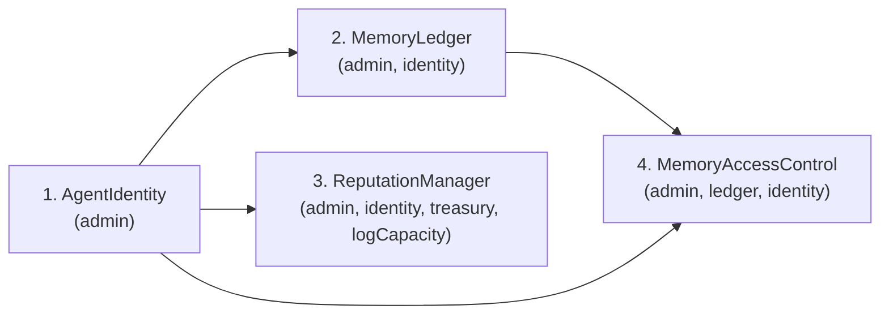

# Deployment and Operations

> **Testnet only.** Nothing in this repository is audited. Do not deploy these contracts to a network
> where value is at stake, and do not point a key holding mainnet funds at any part of it. See
> [SECURITY-NOTES.md](./SECURITY-NOTES.md) — there is one open **critical** finding and several
> **high** ones.

---

## Contents

- [1. Prerequisites](#1-prerequisites)
- [2. Local development](#2-local-development)
- [3. Docker](#3-docker)
- [4. Docker Compose](#4-docker-compose)
- [5. HuggingFace Spaces](#5-huggingface-spaces)
- [6. Contract deployment to Sepolia](#6-contract-deployment-to-sepolia)
- [7. Etherscan verification](#7-etherscan-verification)
- [8. The currently deployed addresses](#8-the-currently-deployed-addresses)
- [9. Health checks and probes](#9-health-checks-and-probes)
- [10. Graceful shutdown](#10-graceful-shutdown)
- [11. Observability](#11-observability)
- [12. Operations runbook](#12-operations-runbook)
- [13. CI pipeline](#13-ci-pipeline)

---

## 1. Prerequisites

| Requirement        | Version                        | Why                                                                                          |
| ------------------ | ------------------------------ | -------------------------------------------------------------------------------------------- |
| Node.js            | **>= 20**, `>= 22` recommended | `package.json` `engines`; the Docker image is `node:22-bookworm-slim`                        |
| npm                | >= 10                          | `package.json` `engines`                                                                     |
| Docker             | any recent                     | Optional; Compose v2 **>= 2.24** for the `env_file` long form                                |
| Sepolia RPC URL    | —                              | A keyed provider. Public `rpc.sepolia.org` is rate limited and makes deploys look like hangs |
| Funded Sepolia key | —                              | **Testnet-only.** Get ETH from a Sepolia faucet                                              |
| Pinata JWT         | —                              | Required to pin. Scope it as narrowly as your account allows                                 |
| Etherscan API key  | —                              | Only for contract verification                                                               |

Roughly 1 GB of free disk for `node_modules`, plus about 90 MB per embedding model in
`TRANSFORMERS_CACHE`.

> **glibc, not musl.** `@huggingface/transformers@4` depends on `onnxruntime-node`, whose prebuilt
> native library is glibc-only. On an Alpine base `npm ci --omit=dev` **succeeds silently** and the
> failure only appears at runtime on the first import:
> `Error loading shared library ld-linux-x86-64.so.2`. A musl base is viable only with
> `NEUROMESH_EMBEDDING_PROVIDER=mock`.

---

## 2. Local development

```bash
git clone https://github.com/v3nom-95/NeuroMesh.git
cd NeuroMesh
npm ci

cp .env.example .env          # Windows: copy .env.example .env
# edit .env — see docs/CONFIGURATION.md

npm test                      # 7 protocol suites + 223 Hardhat tests
npm run dev                   # node --watch server.js
```

Open <http://localhost:7860>.

**A fresh clone with no `.env` still boots.** A missing `PRIVATE_KEY` or RPC URL yields a _read-only_
node, not a crash — the dashboard and every read route work. See
[CONFIGURATION.md §8.1](./CONFIGURATION.md#81-local-development-read-only).

### Useful scripts

| Command                  | What it does                               | Notes                                                                                               |
| ------------------------ | ------------------------------------------ | --------------------------------------------------------------------------------------------------- |
| `npm start`              | `node server.js`                           | Currently the **legacy v1** server — see [API.md Part A](./API.md#part-a--what-is-served-today)     |
| `npm run dev`            | `node --watch server.js`                   | —                                                                                                   |
| `npm test`               | `test:unit` then `test:contracts`          | —                                                                                                   |
| `npm run test:unit`      | `node --test test/backend`                 | Sets no env; the config loader detects the test run and skips `.env`                                |
| `npm run test:contracts` | `hardhat test`                             | **223 passing** at the time of writing                                                              |
| `npm run test:coverage`  | `node --test --experimental-test-coverage` | —                                                                                                   |
| `npm run coverage:sol`   | `hardhat coverage`                         | —                                                                                                   |
| `npm run lint:all`       | ESLint + solhint                           | —                                                                                                   |
| `npm run typecheck`      | `tsc --noEmit` over JSDoc types            | —                                                                                                   |
| `npm run compile`        | `hardhat compile`                          | Solidity 0.8.24, optimizer 200 runs, `evmVersion: cancun`, `viaIR: false`                           |
| `npm run ci`             | lint + format + typecheck + compile + test | What CI runs                                                                                        |
| `npm run simulate`       | `node scripts/simulate.js`                 | Legacy; needs a funded key, an RPC URL and a Pinata JWT                                             |
| `npm run benchmark`      | **also** `node scripts/simulate.js`        | See [BENCHMARKS.md](./BENCHMARKS.md) — this is _not_ the harness that produced the statistics there |
| `npm run audit`          | `npm audit --audit-level=high --omit=dev`  | Production tree is **0 vulnerabilities** via the `sharp` and `adm-zip` overrides                    |

**First run is slow.** With `NEUROMESH_EMBEDDING_PROVIDER=local` the ONNX weights (~90 MB) download
into `TRANSFORMERS_CACHE`. Set `NEUROMESH_EMBEDDING_PROVIDER=mock` to skip it entirely; that is what
CI does.

> **Never commit `.env`.** Verify with `git check-ignore -v .env && git ls-files .env` — the first
> must print a rule, the second must print nothing.

---

## 3. Docker

```bash
npm run docker:build     # docker build -t neuromesh-protocol:local .
npm run docker:run       # docker run --rm --env-file .env -p 7860:7860 neuromesh-protocol:local
```

With build metadata:

```bash
docker build \
  --build-arg VERSION=2.0.0 \
  --build-arg VCS_REF="$(git rev-parse --short HEAD)" \
  --build-arg BUILD_DATE="$(date -u +%Y-%m-%dT%H:%M:%SZ)" \
  -t neuromesh-protocol:local .
```

### What the image does, and why

Two stages, `builder` and `runtime`.

**Builder:**

- Full `npm ci`, dependency layer cached separately from source churn.
- **A secret scan that fails the build** if `.env`, `.env.local` or `.env.production` reached the
  build context — defence in depth in case `.dockerignore` ever regresses.
- A cheap source gate (`node --check server.js`, `JSON.parse(package.json)`) so a syntax error fails
  in the throwaway stage rather than at container start. There is no transpile, bundle or
  `hardhat compile` step.
- An **explicit runtime payload allowlist** assembled at `/out`: `package.json`,
  `package-lock.json`, `server.js`, and whichever of `src`, `lib`, `public`, `protocol`,
  `deployments`, `contract-addresses.json` exist. This is why the runtime stage never does
  `COPY . .` — `.git`, `.env`, `test/`, `scripts/`, `docs/` and the Hardhat config cannot reach the
  final image even if `.dockerignore` is edited badly later.

**Runtime:**

- `npm ci --omit=dev` _inside the runtime image_, so the `onnxruntime` and `sharp` native binaries
  match this exact base. The npm cache is dropped in the same layer so it never ships.
- `tini` as PID 1, which reaps zombies and forwards `SIGTERM`/`SIGINT` to node, so `docker stop`
  actually triggers graceful shutdown instead of being swallowed and then `SIGKILL`ed.
- Runs as `USER node`, non-root.
- `HEALTHCHECK` on `$HEALTHCHECK_PATH` (default `/healthz`), `--start-period=180s` because the first
  boot may download the model.
- OCI labels for title, version, revision, source, licence and base image.

### Secrets

**Never as `ARG` or `ENV`** — both are permanently readable via `docker history`. Secrets are
runtime-only: `--env-file`, `-e`, or Compose. Mount a volume at `/app/.cache` in production so the
model is not re-downloaded on every restart.

---

## 4. Docker Compose

```bash
cp .env.example .env
docker compose up --build

# with a local EVM as well:
docker compose --profile local-chain up
```

Requires Compose **>= 2.24** for the `env_file: [{path, required}]` long form. There is no top-level
`version:` key — it is obsolete and ignored by Compose v2.

Notable choices in `docker-compose.yml`:

| Setting                          | Value                                                                  | Why                                                                                                                                     |
| -------------------------------- | ---------------------------------------------------------------------- | --------------------------------------------------------------------------------------------------------------------------------------- |
| `ports`                          | `127.0.0.1:7860:7860`                                                  | **Loopback**, so a dev box never exposes a node holding a funded testnet key to the LAN. Change to `7860:7860` only behind a real proxy |
| `env_file`                       | `.env`, `required: false`                                              | `docker compose config` and a mock-provider run work on a fresh clone with no `.env`                                                    |
| `environment`                    | `NODE_ENV=production`, `HOST=0.0.0.0`, `LOG_PRETTY=false`, cache paths | These win over `.env` on purpose: container-correct values, not host ones                                                               |
| `volumes`                        | named `transformers-cache` at `/app/.cache`                            | Persists the ~90 MB model across restarts, seeded from the image so it keeps `node:node` ownership                                      |
| `/app/reports`                   | tmpfs, long form, `mode: 0o1777`                                       | The short `tmpfs:` list gives a root-owned `0755` mount that uid 1000 **cannot write to** — verified                                    |
| `read_only`                      | `true`                                                                 | With `/tmp` as tmpfs. If a future change writes elsewhere, add another tmpfs rather than dropping this                                  |
| `security_opt`                   | `no-new-privileges:true`                                               | —                                                                                                                                       |
| `cap_drop`                       | `ALL`                                                                  | —                                                                                                                                       |
| `stop_grace_period`              | `30s`                                                                  | Must exceed `SHUTDOWN_TIMEOUT_MS`                                                                                                       |
| `deploy.resources.limits.memory` | `2g`                                                                   | ONNX inference is the memory driver                                                                                                     |
| `logging`                        | json-file, 10 MB × 3                                                   | —                                                                                                                                       |

> Setting `HOST=0.0.0.0` makes `API_AUTH_TOKEN` **mandatory** — the config schema refuses to boot
> otherwise. See [CONFIGURATION.md §4.3](./CONFIGURATION.md#43-wildcard-bind-requires-a-token).

The `chain` service is opt-in (`--profile local-chain`) and runs `npx hardhat node` on
`127.0.0.1:8545`.

---

## 5. HuggingFace Spaces

Spaces routes to port **7860**, which is why that is the default `PORT`.

1. Create a Space with SDK **Docker**.
2. Push this repository. The `Dockerfile` at the root is used as-is.
3. Set every secret in **Settings → Variables and secrets**, as _Secrets_, never as build args:

   | Name                    | Value                                                    |
   | ----------------------- | -------------------------------------------------------- |
   | `API_AUTH_TOKEN`        | `openssl rand -hex 32`                                   |
   | `SEPOLIA_RPC_URL`       | your keyed endpoint                                      |
   | `PRIVATE_KEY`           | a throwaway testnet key                                  |
   | `PINATA_JWT`            | your token                                               |
   | `MEMORY_ENCRYPTION_KEY` | `openssl rand -hex 32`, **different from `PRIVATE_KEY`** |

4. Set these as plain _Variables_:

   ```dotenv
   NODE_ENV=production
   PORT=7860
   HOST=0.0.0.0
   LOG_PRETTY=false
   TRUST_PROXY=1
   CORS_ALLOWED_ORIGINS=https://<your-space>.hf.space
   TRANSFORMERS_CACHE=/app/.cache/transformers
   SHUTDOWN_TIMEOUT_MS=30000
   ```

**Spaces-specific notes.**

- `HOST=0.0.0.0` is mandatory in a container, and therefore `API_AUTH_TOKEN` is mandatory too.
- `TRUST_PROXY=1` — Spaces terminates TLS at a proxy. Without it the rate limiter keys every request
  on the proxy's IP and protects nothing.
- The Space's filesystem is ephemeral. The model re-downloads on every cold start unless persistent
  storage is attached at `/app/.cache`. Budget for the 180 s health-check start period.
- A free Space sleeps. The first request after a sleep pays the full cold-load cost.
- **A public Space is a public wallet-spending API unless `API_AUTH_TOKEN` is set and kept secret.**

---

## 6. Contract deployment to Sepolia

> **`scripts/deploy.js` is stale and will fail.** It was written for the pre-rewrite contracts and
> calls constructors that no longer exist:
>
> | Script calls                                | v2 constructor actually is                                                                         |
> | ------------------------------------------- | -------------------------------------------------------------------------------------------------- |
> | `AgentIdentity.deploy()`                    | `AgentIdentity(address admin)`                                                                     |
> | `MemoryLedger.deploy()`                     | `MemoryLedger(address admin, address identity_)`                                                   |
> | `ReputationManager.deploy(identityAddress)` | `ReputationManager(address admin, address identity_, address treasury_, uint256 trustLogCapacity)` |
> | _(never deployed)_                          | `MemoryAccessControl(address admin, address ledger_, address identity_)`                           |
>
> Running `npm run deploy:sepolia` today fails at the first factory call. Fixing the script belongs
> to the contract lane; the correct sequence is below so it can be done by hand in the meantime.

### Deployment order

Dependencies are `immutable` and validated at construction (non-zero **and** non-empty
`code.length`), so the order is forced:



### Constructor arguments

| Contract              | Arguments                                             | Constraints                                                                                                                                           |
| --------------------- | ----------------------------------------------------- | ----------------------------------------------------------------------------------------------------------------------------------------------------- |
| `AgentIdentity`       | `admin`                                               | Non-zero. Receives `DEFAULT_ADMIN_ROLE`, `PAUSER_ROLE`, `REGISTRAR_ROLE`                                                                              |
| `MemoryLedger`        | `admin`, `identity_`                                  | `identity_` must be a contract. Admin also gets `MODERATOR_ROLE`                                                                                      |
| `ReputationManager`   | `admin`, `identity_`, `treasury_`, `trustLogCapacity` | `identity_` a contract; `treasury_` non-zero; `trustLogCapacity` in `1 … 65536`. Admin also gets `PARAM_ADMIN_ROLE`, `SLASHER_ROLE`, `TREASURER_ROLE` |
| `MemoryAccessControl` | `admin`, `ledger_`, `identity_`                       | Both must be contracts. Admin also gets `MODERATOR_ROLE`                                                                                              |

`ReputationManager` sets its governed parameters in the constructor: `halfLifeSeconds = 90 days`,
`priorWad = 3e18`, `trustThresholdWad = 6e17`, `negativeMultiplierWad = 3e18`,
`baseEndorserWeightWad = 2.5e17`, `maxEndorserWeightWad = 1e18`, `endorseCooldown = 1 day`,
`reportCooldown = 1 day`, `actorCooldown = 1 hour`, `endorsementStakeWei = 0`,
`stakeLockPeriod = 7 days`. All are adjustable afterwards by `PARAM_ADMIN_ROLE` within the bounds in
`contracts/libraries/Limits.sol`.

### Post-deployment checklist

1. `node scripts/gen-abi.js` — regenerate `src/abi/` from `artifacts/contracts/`, then
   `node scripts/gen-abi.js --check` to confirm the tree and the artifacts agree.
2. Write the addresses to `deployments/11155111.json` and point `CONTRACT_ADDRESSES_PATH` at it, or
   set the four `CONTRACT_*` overrides.
3. Confirm each contract's `*_TYPEHASH()` getter returns the value in `src/abi/typehashes.json`:
   - `AgentIdentity.REGISTRATION_TYPEHASH` → `0xe26beaeac1093ef4abf34fe924b2e8901da1bf3f52ef2f26ba1153d4c6226013`
   - `AgentIdentity.KEY_ROTATION_TYPEHASH` → `0x42e4fec868f42b9b63174ebef878ed7171da35b37d973619402c0402c5dadd95`
   - `MemoryLedger.MEMORY_COMMIT_TYPEHASH` → `0xd537da8d8ff1559f87f59432cd5ee7bd8772f0021831af2f900c1c805b36e15b`
   - `MemoryLedger.MEMORY_REVOCATION_TYPEHASH` → `0x70ea8314b377ec34bdb94e724f95fdbd476011dea78d621167b1323a0c906d77`
   - `MemoryAccessControl.ACCESS_GRANT_TYPEHASH` → `0x95c19433783b1cfd701b63cced7f4844b63f729f32da41c09e4bb1995569223e`
4. Confirm `eip712Domain()` on the three EIP-712 contracts returns the names in
   [PROTOCOL.md §8.1](./PROTOCOL.md#81-domains--three-not-one). **`ReputationManager` has no EIP-712
   mixin and `eip712Domain()` reverts on it — that is expected, not a failure.**
5. Restart the node and confirm `/readyz` reports `contractsCompatible: true`.
6. Move `DEFAULT_ADMIN_ROLE` to a multisig behind a timelock, hand `PAUSER_ROLE` to an operational
   hot key, and have the deployer renounce. `contracts/libraries/Roles.sol` documents the intended
   posture; role holders are enumerable on chain via `AccessControlEnumerable`.

---

## 7. Etherscan verification

> **`npm run verify` is broken.** `package.json` maps it to `hardhat run scripts/verify.js`, and
> `scripts/verify.js` does not exist. `scripts/` contains `deploy.js`, `gen-abi.js`,
> `generate-report.js` and `simulate.js`. Use `npx hardhat verify` directly.

`hardhat.config.js` does not currently declare an `etherscan` block, so add one (or pass the key via
`--api-key` if your Hardhat version supports it) before verifying:

```bash
export ETHERSCAN_API_KEY=...

npx hardhat verify --network sepolia <AgentIdentity>        <admin>
npx hardhat verify --network sepolia <MemoryLedger>         <admin> <identity>
npx hardhat verify --network sepolia <ReputationManager>    <admin> <identity> <treasury> <logCapacity>
npx hardhat verify --network sepolia <MemoryAccessControl>  <admin> <ledger> <identity>
```

Verification only succeeds when the compiler settings match exactly: **Solidity 0.8.24, optimizer
enabled, 200 runs, `evmVersion: cancun`, `viaIR: false`**.

---

## 8. The currently deployed addresses

From `contract-addresses.json`:

| Contract              | Network            | Address                                      | Explorer                                                                                |
| --------------------- | ------------------ | -------------------------------------------- | --------------------------------------------------------------------------------------- |
| `AgentIdentity`       | Sepolia (11155111) | `0xD4F91196316f802B67C6B17e0B1845A23beaA2ad` | [view](https://sepolia.etherscan.io/address/0xD4F91196316f802B67C6B17e0B1845A23beaA2ad) |
| `MemoryLedger`        | Sepolia (11155111) | `0x10701017eC0faed2309E103C51AB503214F940Fb` | [view](https://sepolia.etherscan.io/address/0x10701017eC0faed2309E103C51AB503214F940Fb) |
| `ReputationManager`   | Sepolia (11155111) | `0x8E56B730894474e8770b38b4a4A0428f224635ac` | [view](https://sepolia.etherscan.io/address/0x8E56B730894474e8770b38b4a4A0428f224635ac) |
| `MemoryAccessControl` | —                  | **not deployed**                             | —                                                                                       |

> ### These are PRE-REWRITE v1 contracts
>
> **Their ABI does not match the v2 suite in `contracts/`.** They were deployed before the rewrite,
> from the old sources. The differences are not cosmetic:
>
> - `MemoryLedger.commitMemory` took `(string cid, string previousVersionCID, bytes signature, bool isEncrypted, uint256 embeddingDim, string embeddingModel)` and **never read the signature**. The v2 signature is `commitMemory(MemoryInput calldata)`.
> - `verifyMemory` gained a trailing `bool revoked`.
> - `globalReputation` **changed units**: an unbounded integer scaled by 1000, compared against a hardcoded 500, is now a WAD ratio in `[0, 1)` compared against `0.6e18`.
> - `AgentIdentity.registerAgent` took a `string publicKey`; it now takes `(bytes publicKey, string metadataURI)`.
> - The v1 contracts have no `AccessControl`, no `Pausable`, no EIP-712 and no nonces.
>
> The node treats this as a **degraded** state, not a crash: read-only routes and the dashboard keep
> working while `/readyz` reports `contractsCompatible: false`. This is exactly the failure the
> hand-transcribed ABI fragments in `server.js` and `scripts/simulate.js` would have turned into
> silently wrong numbers on a dashboard, which is why `src/abi/` is generated and checked.
>
> **Verification status on Etherscan is not asserted here.** Open the Contract tab on each address to
> check; do not take an unverified claim from a document.
>
> A v2.1 deployment should write `deployments/11155111.json` and move these three to a legacy section.

---

## 9. Health checks and probes

| Endpoint       | Purpose    | Touches                     | Use for                                          |
| -------------- | ---------- | --------------------------- | ------------------------------------------------ |
| `GET /healthz` | Liveness   | nothing                     | Docker `HEALTHCHECK`, k8s `livenessProbe`        |
| `GET /readyz`  | Readiness  | model, RPC, contracts, IPFS | k8s `readinessProbe`, load-balancer registration |
| `GET /metrics` | Prometheus | counters only               | Scraping                                         |

Full response shapes in [API.md §B6](./API.md#b6-operational-endpoints).

**Never point a liveness probe at `/readyz`.** A transient RPC outage makes the node not-ready, and a
liveness probe on that path would restart a perfectly healthy process in a loop.

Suggested Kubernetes probes:

```yaml
livenessProbe:
  httpGet: { path: /healthz, port: 7860 }
  initialDelaySeconds: 20
  periodSeconds: 30
  failureThreshold: 3
readinessProbe:
  httpGet: { path: /readyz, port: 7860 }
  initialDelaySeconds: 10
  periodSeconds: 10
  failureThreshold: 3
startupProbe:
  httpGet: { path: /healthz, port: 7860 }
  periodSeconds: 10
  failureThreshold: 30 # 300 s, covers the model download
```

---

## 10. Graceful shutdown

On `SIGTERM` or `SIGINT`:

1. Stop accepting new connections.
2. Let in-flight requests finish, bounded by `SHUTDOWN_TIMEOUT_MS` (default 10000).
3. Close SSE streams and the RPC provider.
4. Exit 0. On timeout, exit non-zero after dropping what remains.

Two operational requirements:

- **`tini` must be PID 1.** Node as PID 1 does not get default signal handlers, so `SIGTERM` is
  swallowed and Docker eventually `SIGKILL`s it — no drain at all. The image sets
  `ENTRYPOINT ["/usr/bin/tini", "--"]` and compose additionally sets `init: true`.
- **`stop_grace_period` must exceed `SHUTDOWN_TIMEOUT_MS`.** Compose uses `30s` against a 10 s
  default. If you raise `SHUTDOWN_TIMEOUT_MS`, raise the grace period too.

A commit in flight during shutdown may have already broadcast its transaction. The drain does not
cancel it — the transaction lands or does not, independently of the process. Re-check the ledger
after a restart rather than assuming an interrupted commit failed.

---

## 11. Observability

**Logging.** `pino` with `pino-http`. Newline-delimited JSON in production (`LOG_PRETTY=false`),
human-readable via `pino-pretty` in development. Every log line carries the request id from
`X-Request-Id`. The redaction list is built from `SECRET_KEYS` in `src/config/env.js`, so
`PRIVATE_KEY`, `PINATA_JWT`, `API_AUTH_TOKEN`, `MEMORY_ENCRYPTION_KEY`, `METRICS_TOKEN`,
`ETHERSCAN_API_KEY` and `COINMARKETCAP_API_KEY` never reach a log.

**Metrics.** `prom-client` at `/metrics`, gated on `METRICS_ENABLED` and optionally on
`METRICS_TOKEN`.

**Tracing.** An inbound `X-Request-Id` is honoured so a trace can span a proxy — but **only when it
matches a strict character class**, because an unvalidated header echoed into a response is a
header-injection sink.

### What to alert on

| Signal                                               | Why it matters                                                                          |
| ---------------------------------------------------- | --------------------------------------------------------------------------------------- |
| `/readyz` reporting `contractsCompatible: false`     | The deployment and the ABI have diverged. **Currently the expected state.**             |
| Rate of `502 cid_mismatch`                           | The pinning service is returning CIDs that do not address the submitted bytes           |
| Rate of `503 ipfs_unavailable` / `chain_unavailable` | Upstream outage                                                                         |
| Rate of `409 conflict` on `POST /memories`           | Could be ordinary duplicates — **or CID front-running (SEC-01)**                        |
| Signer balance                                       | A node that cannot pay gas fails every write with `insufficient_funds`                  |
| `overloaded` responses                               | `EMBED_QUEUE_MAX` or `TX_QUEUE_MAX` saturated                                           |
| p95 commit latency                                   | Dominated by Sepolia inclusion, not by NeuroMesh — see [BENCHMARKS.md](./BENCHMARKS.md) |

---

## 12. Operations runbook

### 12.1 Node will not start

```text
Invalid configuration - N problems found:
  API_AUTH_TOKEN  is required in production - every mutating route is gated on it.
```

The config loader prints **every** problem at once, by variable name, and **never prints a value**.
Fix them all, then restart. See [CONFIGURATION.md §4](./CONFIGURATION.md#4-cross-field-rules-that-block-boot).

### 12.2 Node starts but every write returns `403 read_only`

`PRIVATE_KEY` is unset, or no RPC URL is configured. `readOnly = !hasSigner || rpcUrls.length === 0`.
This is a valid configuration, not a bug. Check `/api/v1/status` → `signer.readOnly`.

### 12.3 `/readyz` reports `contractsCompatible: false`

Expected today (§8). To confirm it is the stale deployment and not something new:

1. Check `/api/v1/status` → `chain.addresses` and `addressesSource`.
2. Call each contract's `*_TYPEHASH()` getter and compare against `src/abi/typehashes.json`.
3. Compare `eth_getCode` size and hash against `DEPLOYED_BYTECODE_SIZES` / `DEPLOYED_BYTECODE_HASHES`.

**Resolution:** redeploy per §6, regenerate `src/abi/`, update the address file, restart.

### 12.4 Commits fail with `502 cid_mismatch`

The pinning service returned a CID that does not address the bytes the node produced. **The node is
correct to refuse.** Check whether anything is transforming the request body — a proxy that
re-serialises JSON destroys canonical bytes. Check the Pinata status page. Nothing is anchored on
chain when this happens, so there is no cleanup.

### 12.5 Commits fail with `409 conflict` (`MemoryAlreadyExists`)

Either an honest duplicate (the same canonical content produces the same CID by design), or **CID
front-running**: someone observed the CID and committed it first. Check `getMemoryByCid(cid).owner`.
If it is not you, **the record is unrecoverable** — revocation is owner-only and the tombstone never
frees the key. This is critical finding SEC-01, unmitigated. See
[SECURITY-NOTES.md](./SECURITY-NOTES.md).

### 12.6 First request is very slow or times out

Cold model load. `MODEL_PRELOAD=true` moves the cost to boot. Mount a volume at
`TRANSFORMERS_CACHE`. Measured cold load on the reference machine: 197.3 ms (MiniLM) and 665.5 ms
(DistilRoBERTa) _after_ the weights are on disk — the multi-second case is the download.

### 12.7 Rate limiting fires for everyone at once

`TRUST_PROXY` is wrong, so every request keys on the proxy's IP. Set it to `1`, `loopback` or a hop
count matching your topology.

### 12.8 Container exits immediately

Check the config report on stderr first. Then confirm `tini` is PID 1 and that you are not on an
Alpine base (§1).

### 12.9 Incident response — pausing

`PAUSER_ROLE` can `pause()` each contract. Pause blocks entrypoints that create new state and
deliberately leaves `AgentIdentity.deactivate`, `ReputationManager.claimStake`, moderation and role
administration available.

> **Two pause exemptions are currently broken.** `claimStake` is pause-exempt but its precondition
> `revokeEndorsement` is **not**, so pausing freezes every endorsement stake that has not already
> been revoked — exactly the property the exemption exists to guarantee. SEC-08 / NM-08. With
> `endorsementStakeWei = 0` by default, no funds are actually at risk today.

### 12.10 Key rotation

1. Bump `ENCRYPTION_KEY_VERSION`.
2. Restart; the node derives an unrelated keypair by HKDF.
3. Call `AgentIdentity.rotateKey(newPublicKey)` to publish it and increment the on-chain version.
4. **Memories sealed under the old version stay readable only with the old key.** Rotation is not
   re-encryption; existing recipient entries are not rewritten.

If the **wallet** key is compromised, rotation is not enough — the wallet key derives every
encryption key ever used at every version. Move to a new wallet and re-register.

### 12.11 Compromised secret

| Secret                  | Action                                                                                                                          |
| ----------------------- | ------------------------------------------------------------------------------------------------------------------------------- |
| `PRIVATE_KEY`           | Sweep the wallet, register a new agent. Every past encryption key is derivable from it                                          |
| `PINATA_JWT`            | Revoke and reissue in Pinata. Already-pinned content stays pinned                                                               |
| `API_AUTH_TOKEN`        | Rotate and restart. Assume every write made with it was authorised                                                              |
| `MEMORY_ENCRYPTION_KEY` | Rotate per §12.10. **Memories already sealed under it stay decryptable by whoever holds it** — the ciphertext is on public IPFS |

If a secret ever reached a commit: rotate first, then purge history with `git filter-repo`, then
force-push. Rotation comes first because history purging is not instantaneous and forks may exist.

---

## 13. CI pipeline

`.github/workflows/ci.yml`, plus `codeql.yml` and `secret-scan.yml`.

| Job          | What it runs                                                                                                                                                                                                                        |
| ------------ | ----------------------------------------------------------------------------------------------------------------------------------------------------------------------------------------------------------------------------------- |
| `lint`       | ESLint, Prettier check, solhint; asserts no `.env` is tracked; asserts `.env.example` carries no real secret                                                                                                                        |
| `typecheck`  | `tsc --noEmit` over the JSDoc types                                                                                                                                                                                                 |
| `contracts`  | `hardhat compile` and `hardhat test`, with a Solidity-compiler download cache                                                                                                                                                       |
| `backend`    | `node --test test/backend` on a Node version matrix, plus coverage on Node 22                                                                                                                                                       |
| `audit`      | `npm ci --ignore-scripts`; `npm audit --omit=dev --audit-level=high` **must pass**; a moderate-level audit over all dependencies is informational; `npm ls --omit=dev --depth=0` asserts the lockfile satisfies the production tree |
| `docker`     | Builds the image (no push) and asserts no `.env`/`.git`/build-only path was baked in, that the container does not run as root, and that devDependencies are absent from the runtime image                                           |
| `ci-success` | Fails if any job failed or was cancelled                                                                                                                                                                                            |

**CI is hermetic by construction: no job consumes a repository secret.** Contract tests run against
Hardhat's in-process EVM and backend tests run with `NEUROMESH_EMBEDDING_PROVIDER=mock`, so neither
needs `SEPOLIA_RPC_URL`, `PRIVATE_KEY`, `PINATA_JWT` or `ETHERSCAN_API_KEY`. Two jobs contain an
"Assert tests are hermetic" step so that wiring a secret in later fails loudly rather than silently
making pull-request builds from forks unrunnable.

Actions are pinned by major-version tag and kept current by `.github/dependabot.yml`. Commit-SHA
pinning is strictly stronger against a tag-rewrite attack; that trade-off is documented in
`CONTRIBUTING.md`.

---

## See also

- [CONFIGURATION.md](./CONFIGURATION.md) — every variable referenced here
- [API.md](./API.md) — probe and status response shapes
- [SECURITY-NOTES.md](./SECURITY-NOTES.md) — SEC-01 and SEC-08, referenced in the runbook
- [ARCHITECTURE.md](./ARCHITECTURE.md) — the full failure-mode table
- [BENCHMARKS.md](./BENCHMARKS.md) — the latency figures behind the timeout budgets
